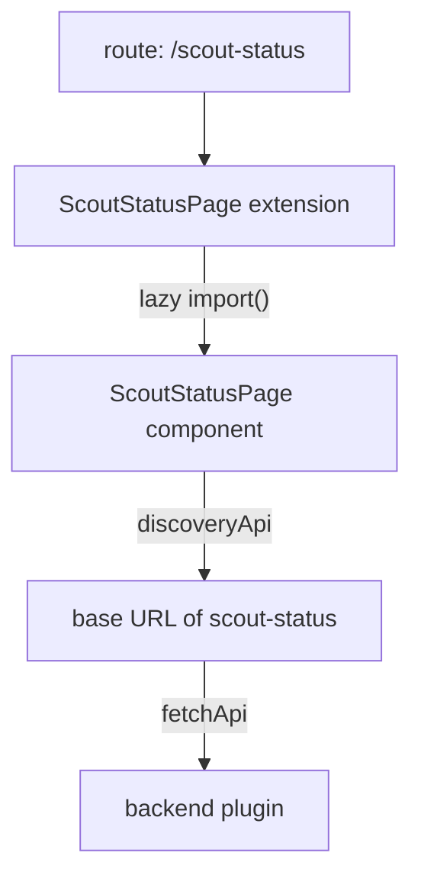

# What A Frontend Plugin Package Contains

A Backstage app is a web application, so every feature that a user sees in the browser comes from a frontend plugin. The portal for the Starfleet scouts needs a page that lists the state of each scout. That page is a frontend plugin. To add it, or to find out why it does not show up, you must know which files make up the plugin and which file does which job.

This part walks through the `scout-status` plugin package in the playground. It uses the legacy frontend system, which is the system most existing Backstage apps still use. The new frontend system comes later in this module.

## The files of a plugin package

A frontend plugin is a normal package in the `plugins/` folder of the repository. The name of the folder is `scout-status`, and the name of the package is `@internal/plugin-scout-status`. The package has a `src/index.ts` file, which is the entry point. Anything the app can import must be exported from that file.

The package has four kinds of source files:

- `routes.ts` holds route references. A route reference (`RouteRef`) is a small object that stands for a page address without hard-coding the URL.
- `plugin.ts` creates the plugin object and the extensions the plugin offers.
- `components/` holds the React components that draw the page.
- `index.ts` exports the plugin and its extensions for the app package.

The `package.json` of the plugin has a `backstage` block with `role: frontend-plugin` and `pluginId: scout-status`. The Backstage command-line tool reads that block to know what kind of package it builds and which backend package belongs to it.

Start the playground and look at the package.

<!-- astrona:playground:renew -->

```sh
cd ~/backstage-app
find plugins/scout-status -type f | sort
```

The command prints every file of the frontend plugin, one path per line. You should see `package.json`, `src/index.ts`, `src/plugin.ts`, `src/routes.ts` and the component files under `src/components/ScoutStatusPage`.

## The plugin object

The plugin object is created with `createPlugin` from `@backstage/core-plugin-api`. It gets an `id` and a `routes` map. Print the file:

```sh
cat plugins/scout-status/src/plugin.ts
```

The first half of the file creates the plugin:

```ts
export const scoutStatusPlugin = createPlugin({
  id: 'scout-status',
  routes: {
    root: rootRouteRef,
  },
});
```

The `id` must be unique in the app. Backstage uses it to name the plugin in the app and in error messages. The `routes` map lists the route references that the plugin exposes, and `root` is the name the plugin gives to its main page. The plugin object alone does not draw anything. It is a container that owns extensions.

## Extensions and routable extensions

An extension is a piece of the user interface that a plugin gives to the app. In the legacy system, a plugin gives an extension to the app with the `provide` method of the plugin object. The second half of `plugin.ts` creates the page:

```ts
export const ScoutStatusPage = scoutStatusPlugin.provide(
  createRoutableExtension({
    name: 'ScoutStatusPage',
    component: () =>
      import('./components/ScoutStatusPage').then(m => m.ScoutStatusPage),
    mountPoint: rootRouteRef,
  }),
);
```

`createRoutableExtension` makes an extension that can be placed on a route. It takes three options. `name` is the name of the extension. `component` is a function that loads the React component with a dynamic `import()`, so the browser downloads the code of the page only when a user opens it. `mountPoint` is the route reference that tells Backstage which route belongs to this page.

The result of `provide` is a React component. The app imports it by name and puts it in a route element. If you forget this step, the plugin exists but there is no page to place. The app must still import and route it.

## Route references

Look at `routes.ts`:

```sh
cat plugins/scout-status/src/routes.ts
```

The file creates the route reference with `createRouteRef({ id: 'scout-status' })`. A route reference has no URL of its own. The URL is chosen later by the app, in the `path` of the route element that renders the extension. Plugins link to each other through route references, so the app author can move a page to another URL without editing the plugins.

## Talking to a backend

The component file draws the page and loads data. Search for the lines that find the backend:

```sh
grep -n "useApi\|getBaseUrl\|fetchApi" plugins/scout-status/src/components/ScoutStatusPage/ScoutStatusPage.tsx
```

`useApi` is a React hook from `@backstage/core-plugin-api` that returns an implementation of an API when you give it an API reference. The component asks for `discoveryApiRef`, and calls `getBaseUrl('scout-status')`. The discovery API answers with the base URL of the backend plugin that has the plugin id `scout-status`, for example `http://localhost:7007/api/scout-status`. Then the component uses `fetchApiRef` to call `/status` on that address. The `fetchApi` adds the identity token of the signed-in user to the request.

The component also uses `useAsync` from the `react-use` library to run the request and to keep the three states: loading, error and value. While the request runs, it renders `Progress`. If the request fails, it renders `ResponseErrorPanel`. Both come from `@backstage/core-components`.



The diagram shows how a visit to the route leads to the component, and how the component finds the backend through the discovery API instead of a fixed address.

## What the plugin does not do

The plugin package does not run on the server and it does not hold secrets. Everything in it is downloaded by the browser, so every user can read it. Code that needs a credential, a database or a private network address belongs in a backend plugin. The frontend plugin only asks the backend for the result.

You now know the files of a frontend plugin: the entry point, the plugin object, the routable extension, the route reference and the component. One question remains: the package exists, but how does the app learn about it?

## Common pitfalls

> [!WARNING]
> A plugin package that is not imported by the app does nothing, even when its code is correct. Do not put credentials in a frontend plugin, because the browser downloads all of its code. Do not hard-code the backend address: ask the discovery API for the base URL of the plugin id instead. Export every extension from `index.ts`, because the app cannot import a file that the package does not export.
