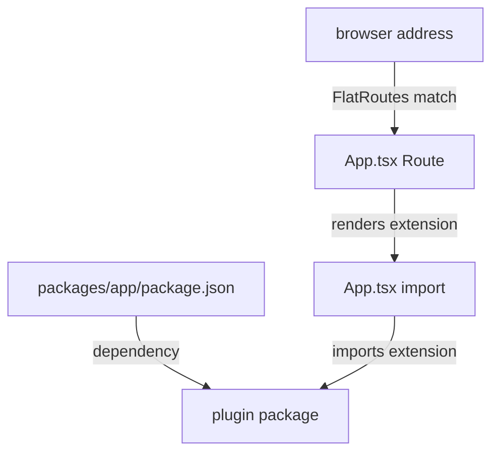

# Registering A Plugin In The App Package

A plugin package is only a library until an app uses it. In a Backstage repository the app is the package in `packages/app`, and it is the place where the browser code is assembled from the plugins. A page can be missing even though the plugin package is correct, and the cause is nearly always a missing step in the app package. This part follows the steps that connect a plugin to the app, and shows how to tell which step is missing.

## Three steps in the legacy system

In the legacy frontend system, the app author registers a plugin page with three steps. Each step lives in a different file, and each step fails in a different way.

1. The app package depends on the plugin package. This is a line in `packages/app/package.json`.
2. The app source imports the extension from the plugin package. This is an `import` line in `packages/app/src/App.tsx`.
3. The app source places the extension in a route. This is a `Route` element inside `FlatRoutes` in `App.tsx`.

Look at the first step in the playground.

<!-- astrona:playground:renew -->

```sh
cd ~/backstage-app
grep -n "scout-status" packages/app/package.json
```

The command prints the line `"@internal/plugin-scout-status": "workspace:^"`. The `workspace:^` version tells the package manager (Yarn) to use the package from the `plugins/` folder of the same repository instead of downloading it from a registry. Without the line, the import in step 2 cannot be resolved and the app does not build.

## Importing and routing

Now read the app file:

```sh
cat packages/app/src/App.tsx
```

The file creates the app with `createApp` from `@backstage/app-defaults`, then calls `app.createRoot(...)` with a tree of React elements. Three parts matter for plugins.

`AppRouter` is the component from `@backstage/core-app-api` that connects the app to the address bar of the browser. `FlatRoutes` is a component from the same package that picks one `Route` that matches the current address. It works like the React Router `Routes` component, but it also lets plugin routes that are declared deep in the tree take part in the match.

The import line brings the extension in:

```tsx
import { ScoutStatusPage } from '@internal/plugin-scout-status';
```

The route element places it:

```tsx
<Route path="/scout-status" element={<ScoutStatusPage />} />
```

The `path` is chosen by the app author. The route reference inside the extension (`rootRouteRef`) gets this path when the app starts, so other plugins that link to `rootRouteRef` land on `/scout-status`.

## What each missing step looks like

The three steps produce different symptoms. Knowing the symptom saves time.

If the dependency is missing in `package.json`, the build of the app stops with a message that it cannot resolve `@internal/plugin-scout-status`. If the dependency exists but `App.tsx` has no import, the app builds and runs, and the sidebar and pages work, but nothing in the code mentions the plugin. If the import exists but there is no `Route`, the app builds and the browser shows the not-found page at `/scout-status`, because no route matches. A route that exists but is outside `FlatRoutes` can be ignored in the same way.

Check the three steps with `grep`. Each command prints the matching lines with their line numbers:

```sh
grep -n "plugin-scout-status" packages/app/package.json packages/app/src/App.tsx
grep -n "<FlatRoutes>\|</FlatRoutes>\|<Route" packages/app/src/App.tsx
```

The first command shows the dependency and the import. The second shows where `FlatRoutes` opens and closes and which routes sit between those lines. A route line outside that range does not take part in matching.

## Comments do not register anything

A commented-out route is a common leftover when someone tries a plugin and removes it again. In JSX, a comment inside the tree looks like `{/* <Route ... /> */}`. The build ignores it completely. When you search a file with `grep`, comments match too, so read the result carefully before you decide that a route exists.

## Adding a link in the sidebar

A route makes a page reachable by address. Users usually reach pages through the sidebar, which lives in `packages/app/src/components/Root`. A sidebar item is a separate React element with its own `to` property. The plugin cannot add it by itself in the legacy system, so the app author adds it by hand. A page can work and still be hard to find because the sidebar item is missing.

## Multiple apps and multiple plugins

The rule is the same for any number of plugins: one dependency, one import and one route per page. Two plugins can use the same `path` only if the app author wants one to hide the other, and `FlatRoutes` picks the first match, so order matters when paths overlap. Keep paths unique.



The diagram shows the three connections: the dependency, the import and the route, and how a browser address reaches the extension through `FlatRoutes`.

## Diagnosing a blank or missing page

When the page of a plugin does not show, use the order above. First check that the dependency is in `package.json`. Then check that `App.tsx` imports the extension by the exact exported name. Then check that a real `Route` with the right `path` is inside `FlatRoutes`. If all three are present and the page is blank, the problem is inside the page itself: look at the browser console for an error and at the network tab for a failed request to the backend. A failed request points to the backend plugin, not to the registration.

You now know how the legacy app registers a plugin, and you can read the three symptoms of a missing step. The next question is how the newer frontend system changes this registration.

## Common pitfalls

> [!WARNING]
> Installing the dependency does not register the page. Importing the extension does not add a route. A commented-out `Route` does nothing, even though `grep` finds it. A `Route` outside `FlatRoutes` may never match. Do not copy registration code from a guide for another frontend system without checking which one your app uses.
