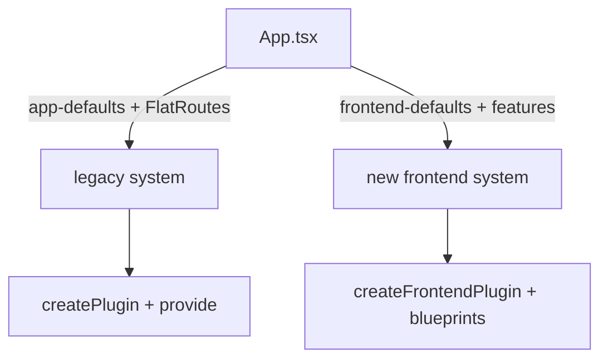

# The New Frontend System: Plugins And Extensions

Backstage has two frontend systems. The legacy system, which the previous pages used, asks the app author to import each page and write a route by hand. The new frontend system, built on the package `@backstage/frontend-plugin-api`, lets a plugin describe its pages, navigation items and APIs as extensions, and the app assembles them. You need to recognize which system an app uses, because the code for one does not work in the other.

## Extensions and blueprints

In the new system, an extension is a unit that has an identifier, inputs and an output, and the app builds a tree from them. A plugin is a group of extensions with one plugin id. The plugin does not place its page. It declares the page, and the app tree decides where it is rendered.

Writing an extension by hand is verbose, so Backstage ships extension blueprints. A blueprint is a ready-made factory for one kind of extension. `PageBlueprint` makes a page that is routed in the app. You give it parameters, and it returns an extension. The extension identifier follows the pattern `page:<pluginId>`; for the `scout-status` plugin the page extension is `page:scout-status`.

## A plugin in the new system

Save this as `plugins/scout-status/src/alpha.tsx`. It describes the same page as the legacy plugin, in the new style:

<!-- astrona:playground:renew -->

```tsx
import {
  createFrontendPlugin,
  createRouteRef,
  PageBlueprint,
} from '@backstage/frontend-plugin-api';

const rootRouteRef = createRouteRef();

const scoutStatusPage = PageBlueprint.make({
  params: {
    routeRef: rootRouteRef,
    path: '/scout-status',
    loader: () =>
      import('./components/ScoutStatusPage').then(m => <m.ScoutStatusPage />),
  },
});

export const scoutStatusFrontendPlugin = createFrontendPlugin({
  pluginId: 'scout-status',
  extensions: [scoutStatusPage],
  routes: {
    root: rootRouteRef,
  },
});

export default scoutStatusFrontendPlugin;
```

The file is the playground copy only. It is not imported by anything, so it does not change the running legacy app. Read what each part does:

- `createFrontendPlugin` replaces `createPlugin`. The option is `pluginId`, not `id`.
- `createRouteRef()` takes no `id` here. The new system derives the identity from the plugin and the route name.
- `PageBlueprint.make({ params })` creates the page extension. `path` is the URL, `routeRef` links the page to the route reference and `loader` returns the React element. The loader uses a dynamic `import()`, so the code loads only when the page opens.
- `extensions` lists what the plugin provides, and `routes` exposes route references to other plugins.

Notice what is missing compared with the legacy plugin: there is no `provide` call, no exported page component and no `Route` in the app. The plugin carries its own path.

## How the app loads the plugin

The new app is created with `createApp` from `@backstage/frontend-defaults`. A plugin is a feature, and a feature can be given to the app in a `features` array:

```tsx
import { createApp } from '@backstage/frontend-defaults';
import scoutStatusPlugin from '@internal/plugin-scout-status';

const app = createApp({
  features: [scoutStatusPlugin],
});
```

The import is the default export of the package, which is why a plugin package for the new system ends its `index.ts` with `export { plugin as default }`. Apps built with the Backstage command-line tool can also use feature discovery: the tool scans the dependencies of the app package and loads the compatible plugins without an import in the source. Discovery is only available when the command-line tool builds the app, so an app built another way must use the `features` array.

Check the file you saved and the legacy app side by side:

```sh
cd ~/backstage-app
grep -n "createFrontendPlugin\|PageBlueprint\|pluginId" plugins/scout-status/src/alpha.tsx
grep -n "createPlugin\|createRoutableExtension" plugins/scout-status/src/plugin.ts
```

The first command finds the new system calls in the file you saved. The second finds the legacy calls in the existing plugin. The two files describe one page with two different APIs.

## Choosing the matching system

A mix of both is not valid. A legacy plugin made with `createPlugin` does not become a feature of an app made with `createApp` from `@backstage/frontend-defaults`. A plugin made with `createFrontendPlugin` does not work as a page inside the legacy `FlatRoutes` without a compatibility layer. Backstage provides compatibility packages that wrap legacy plugins for a new app, and the installation guide of each plugin says which system it supports.

To decide, read the app. If `App.tsx` imports `createApp` from `@backstage/app-defaults` and has `FlatRoutes`, it is a legacy app. If it imports `createApp` from `@backstage/frontend-defaults` and passes `features`, it is a new frontend system app. Then read the plugin: `createPlugin` with `provide` is legacy, and `createFrontendPlugin` with blueprints is new.



The diagram shows that the import in `App.tsx` decides the system, and each system expects its own plugin API.

## What stays the same

Some things do not change between the systems. The frontend plugin still runs in the browser and still holds no secrets. It still finds its backend through the discovery API with the plugin id. The backend plugin does not know which frontend system the app uses, because it serves HTTP requests only. A frontend can be migrated without touching the backend, as long as the plugin id stays the same.

You now know how a plugin is declared, loaded and chosen in the new frontend system. Together with the legacy registration, this covers everything a frontend plugin is. The other half of a feature, the part that runs on the server, is a backend plugin.

## Common pitfalls

> [!WARNING]
> Do not mix legacy and new frontend APIs in one app. `createPlugin` and `createFrontendPlugin` are different functions with different options (`id` against `pluginId`). A plugin for the new system needs a default export for the app to load it. Feature discovery only works when the Backstage command-line tool builds the app. Always check which system the app uses before you copy code from a guide.
