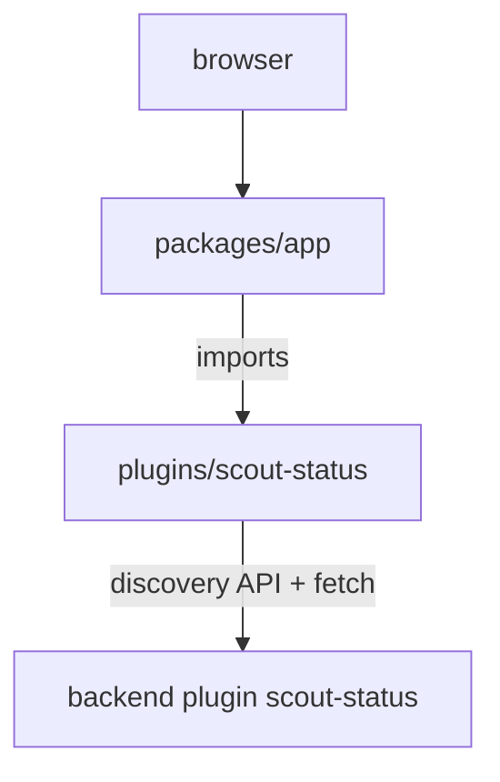

# Frontend Plugins And The Frontend System

This module explains the browser half of a Backstage feature. A frontend plugin is a package that runs in the browser and adds pages, cards and other user interface elements to the app. The module shows what a plugin package contains, how an app registers it, and how the new frontend system changes the way plugins are described and loaded.

The examples use a plugin named `scout-status` that shows the state of the Starfleet scouts. The playground holds a small repository with that plugin, so you can read the real files and follow the connections yourself.

## Learning Goals

- Name the files of a frontend plugin package and the job of each one.
- Explain what `createPlugin`, `createRoutableExtension` and a route reference do in the legacy frontend system.
- Register a plugin page in the app package: dependency, import and route in `FlatRoutes`.
- Describe how the new frontend system declares pages with `createFrontendPlugin` and `PageBlueprint`, and how the app loads them.
- Tell which frontend system an app uses and why code for one system does not work in the other.
- Explain why a frontend plugin holds no secrets and finds its backend through the discovery API.

## Before You Start

You should know what a React component is and how a package in a JavaScript repository lists its dependencies in `package.json`. You do not need to write React code. The hands-on steps use a terminal in a virtual machine with `grep`, `cat`, `find` and `nano`. Nothing is built or started. Terms are defined where they first appear.

## Words used in this module

| Term | Meaning |
| --- | --- |
| Frontend plugin | A package that runs in the browser and provides pages or components to the app |
| App package | The package in `packages/app` that assembles the browser application |
| Extension | A unit of user interface that a plugin gives to the app |
| Routable extension | An extension in the legacy system that is attached to a route reference |
| Route reference | An object that stands for a page address, so plugins do not hard-code URLs |
| `FlatRoutes` | The component in the legacy app that picks the route that matches the address |
| Blueprint | A factory for one kind of extension in the new frontend system, such as `PageBlueprint` |
| Feature | A plugin or other unit that the new frontend app loads |
| Discovery API | An API that returns the base URL of a backend plugin by its plugin id |

## What the hands-on work covers

In the playground you read the `scout-status` plugin from the inside: the entry point, the plugin object, the route reference and the page component. You follow the registration in the app package from the dependency to the route. Then you write a plugin file in the new frontend system style and compare it with the legacy file.

The graded lab after the second reading uses a similar project in which the plugin exists but the app does not use it. You export the page from the plugin, add the dependency, import the page and add the route.

## The three readings

The first reading takes the plugin package apart. The second follows the registration in the app package and shows how to diagnose a missing page. The third introduces the new frontend system and explains how to choose between the two systems.

## How to work

Each reading has at most about eight commands. Read the paragraph before a command, run it, and compare what it prints with the explanation. Commands only read files unless the text says to save a new file. If you change a file by mistake, you can read the original with `cat` in a fresh playground.

The playground is renewed at the start of each hands-on reading, so you have the full time available for that reading. It is removed at the end of the summary.

## The project you will read

The playground project is a small monorepo, which is one repository with several packages. These are the paths that matter for this module:

```text
app-config.yaml
packages/app/package.json
packages/app/src/App.tsx
plugins/scout-status/package.json
plugins/scout-status/src/index.ts
plugins/scout-status/src/plugin.ts
plugins/scout-status/src/routes.ts
plugins/scout-status/src/components/ScoutStatusPage/ScoutStatusPage.tsx
```

The app package depends on the plugin package. The plugin package exports the page. The page asks a backend plugin for data. The backend plugin is part of the same repository; here it only matters as the address the page calls.



The diagram shows the direction of the dependencies: the app depends on the plugin, and the plugin calls the backend at run time.

## Limits of what this module claims

Backstage changes quickly, and the new frontend system is still developing. The module names the APIs that exist in current Backstage releases and avoids version numbers. Your own app can use older or newer releases, so check the package versions in the `package.json` of your app and the documentation for those versions before you copy code.

## Reading Order

1. What A Frontend Plugin Package Contains
2. Registering A Plugin In The App Package
3. The New Frontend System: Plugins And Extensions
4. Summary

<!-- astrona:playground -->
