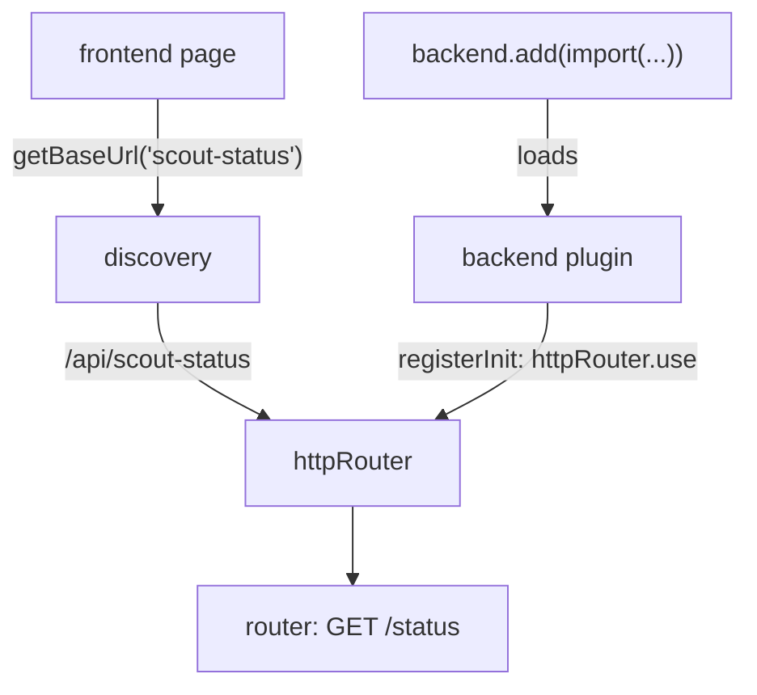

# Backend Plugins And The New Backend System

A frontend plugin runs in the browser, and everything it contains can be read by the user. A feature that needs a secret, a database or a call to a private system must run on a server. In Backstage that is the job of a backend plugin. This part shows how the backend starts, how a backend plugin is defined and how it becomes reachable from the browser.

The examples use the `scout-status` backend plugin from the playground. It answers the request that the `scout-status` frontend page sends.

## One process, many plugins

The Backstage backend is a single Node.js process. The file `packages/backend/src/index.ts` creates the backend and tells it which packages to load. Print it in the playground.

<!-- astrona:playground:renew -->

```sh
cd ~/backstage-app
cat packages/backend/src/index.ts
```

The file has three steps. `createBackend()` from `@backstage/backend-defaults` creates the backend with a default set of services. Each `backend.add(import('...'))` line adds one plugin or module. `backend.start()` starts everything.

```ts
const backend = createBackend();

backend.add(import('@backstage/plugin-app-backend'));
backend.add(import('@internal/plugin-scout-status-backend'));

backend.start();
```

The argument of `backend.add` is a dynamic `import()` of a package. The package must have a default export that is a backend plugin or a backend module. If the line is missing, the package never starts, even when it is installed. If the line is commented out, the result is the same.

This is the new backend system. Older Backstage apps use a different design, where a file in `packages/backend/src/plugins` exports a `createPlugin(env)` function and the backend index calls it by hand. The two designs look different, and the new one is the one that the current documentation and the packages from the community target.

## Defining a backend plugin

A backend plugin is created with `createBackendPlugin` from `@backstage/backend-plugin-api`. Print the plugin:

```sh
cat plugins/scout-status-backend/src/plugin.ts
```

The core of the file is:

```ts
export const scoutStatusPlugin = createBackendPlugin({
  pluginId: 'scout-status',
  register(env) {
    env.registerInit({
      deps: {
        logger: coreServices.logger,
        httpRouter: coreServices.httpRouter,
      },
      async init({ logger, httpRouter }) {
        httpRouter.use(await createRouter({ logger }));
      },
    });
  },
});
```

`pluginId` is the identity of the plugin. It must be unique in the backend. By convention it equals the package name without the `plugin-` prefix and the `-backend` suffix. `register` is called once, early, with an `env` object. `env.registerInit` declares what the plugin needs (`deps`) and the function that starts the plugin (`init`).

The default export of the package connects the plugin to `backend.add`. Check it:

```sh
cat plugins/scout-status-backend/src/index.ts
```

The file contains `export { scoutStatusPlugin as default } from './plugin';`. The `import()` in the backend index returns the module of the package, and the backend reads its default export.

## How a plugin becomes reachable

The `httpRouter` service is the plugin's own HTTP router. When the plugin calls `httpRouter.use(router)`, the backend mounts that router under the path `/api/<pluginId>`. For this plugin the path is `/api/scout-status`. The router file defines `GET /status`, so the full address of the request from the browser is `http://localhost:7007/api/scout-status/status` when the backend listens on port 7007 (set in `app-config.yaml`).

This is why the plugin id matters outside the backend. The frontend component calls `discoveryApi.getBaseUrl('scout-status')`. The discovery service builds the address from the base URL of the backend and the plugin id. If the backend plugin used the id `scout-status-backend`, the router would sit at `/api/scout-status-backend` and the frontend request would fail.

Confirm the two sides in the files:

```sh
grep -rn "scout-status'" plugins/scout-status plugins/scout-status-backend --include=*.ts --include=*.tsx
```

The command lists the lines that use the plugin id: the frontend plugin object, the discovery call and the backend `pluginId`. They must match.



The diagram shows two things: `backend.add` loads the plugin, and the plugin mounts its router under the path of its id, which is the address the frontend finds with the discovery API.

## Frontend and backend together

A feature often has both parts. The frontend plugin draws the page. The backend plugin holds the integration and the credential, checks permissions and returns data. The two packages are installed in two different places: the frontend in the app package and the backend in the backend package. Both appear in the `backstage.pluginPackages` field of the `package.json` of each plugin, so the tooling knows they belong together.

Installing only one side gives a partial feature. A frontend page without its backend shows an error panel with a failed request. A backend plugin without its frontend answers requests that no page sends. Installing a feature therefore means two registrations in two packages.

## What a backend plugin must not do

A backend plugin must not reach into another plugin through private imports. Plugins talk to each other through HTTP APIs and through extension points that they publish. A plugin must also not read configuration with its own file reads or environment variables. The configuration service gives it the merged `app-config.yaml` values.

You now know how the backend starts, how a backend plugin is declared and why its id decides its URL. Next, the `deps` object deserves a closer look, because it is how every plugin gets what it needs.

## Common pitfalls

> [!WARNING]
> An installed backend package does nothing until a `backend.add(import('...'))` line loads it, and a commented-out line does not load it. The plugin id, not the package name, decides the URL path, so it must match what the frontend asks the discovery API for. Do not copy code written for the older backend design into the new one: `createRouter(env)` helpers and a `plugins/` folder wiring belong to the old system.
