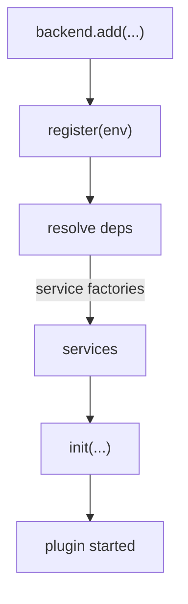

# Core Services And Dependency Injection

A backend plugin needs a logger, an HTTP router, configuration and often a database. If every plugin created its own, the backend would have many loggers, many connections and many ways to read configuration. Backstage solves this with services. A service is a shared facility that the backend creates once and gives to each plugin that asks. This part explains how a plugin asks for services, which services exist in the core set, and why a plugin must never build the facilities itself.

## Service references and `coreServices`

A service is described by a service reference. A service reference is an object that has an identifier and a type, and that stands for one service interface. The package `@backstage/backend-plugin-api` exports the object `coreServices`, which holds the references of the services every backend has by default. Some of them are:

| Reference | What the service provides |
| --- | --- |
| `coreServices.logger` | A logger for the plugin |
| `coreServices.httpRouter` | The HTTP router of the plugin, mounted under `/api/<pluginId>` |
| `coreServices.rootConfig` | The merged configuration of the whole app |
| `coreServices.database` | A database connection for the plugin |
| `coreServices.auth` | Verification and creation of credentials between plugins |
| `coreServices.httpAuth` | The credentials of the incoming HTTP request |
| `coreServices.scheduler` | Scheduling of tasks that run once or repeat |
| `coreServices.lifecycle` | Hooks that run when the backend starts or stops |

Some services are plugin scoped: the backend creates a separate instance for each plugin, so the logger of `scout-status` tags its lines with that plugin id, and `httpRouter` knows the plugin id for its path. Other services are root scoped: one instance serves the whole backend, such as `rootConfig`.

## Declaring dependencies

A plugin lists what it needs in `deps`, and the backend passes the implementations into `init`. This pattern is called dependency injection: the plugin does not create the service, it receives it. Read the plugin file.

<!-- astrona:playground:renew -->

```sh
cd ~/backstage-app
grep -n "deps\|coreServices\|async init" plugins/scout-status-backend/src/plugin.ts
```

The keys in `deps` are names that the plugin chooses (`logger`, `httpRouter`). The values are service references. The object that `init` receives has the same keys, with the implementations as values. In the example, `logger` is a `LoggerService` and `httpRouter` is an `HttpRouterService`.

You can name a key differently. This is valid:

```ts
deps: {
  log: coreServices.logger,
},
async init({ log }) {
  log.info('started');
},
```

The name only has to match between `deps` and the destructured argument of `init`. The type of `log` comes from the reference.

## Reading configuration safely

A plugin that needs a setting asks for `coreServices.rootConfig`. The service has typed readers, such as `getString`, `getOptionalString`, `getNumber` and `getConfig`. A missing required key makes the reader throw an error when the plugin starts, so the backend fails early with a clear message, not later with a confusing one.

Find the configuration that the playground backend can read:

```sh
cat app-config.yaml
```

The file has a `backend` block with the base URL and the listen port, and a `scoutStatus` block with a `statusUrl`. A backend plugin reads values like these with `config.getString('scoutStatus.statusUrl')`. Secrets belong in this configuration, not in the source, and the value is usually written as `${ENV_NAME}`, so the real value comes from the environment of the backend process. Frontend plugins cannot read backend configuration unless the key is marked as visible to the frontend, which is another reason to keep secrets on the server side.

## Why not build the facilities directly

Imagine a plugin that creates its own logger with a library. It would ignore the log format and level that the operator set for the backend. A plugin that opens its own database connection would ignore the connection settings and the per-plugin database isolation. A plugin that reads `process.env` directly would ignore configuration files. With services, the operator configures the facilities once and every plugin follows, and a test can replace a service with a fake.

## Initialization and the lifecycle

The backend does the work in a fixed order. It loads every package given to `backend.add`, calls each `register`, and sorts the plugins and modules by their dependencies. Then it runs the `init` functions. A plugin `init` runs once, and it can be asynchronous. The backend waits for it to finish before it reports the plugin as started. If an `init` throws an error, the backend fails to start and the error names the plugin.



The diagram shows the order: add, register, resolve the services listed in `deps`, then run `init`.

## Service factories and replacement

A service has a factory, which is code that creates its implementation. `createBackend()` from `@backstage/backend-defaults` includes default factories for the core services. An operator can add a different factory for a service to the backend, for example a different logger, and every plugin gets the new implementation without any change in the plugin code. Plugins can also publish their own services for other plugins, but the core set covers the common needs.

Look at the router file, which receives a `LoggerService` as a plain option and does not create one:

```sh
grep -n "LoggerService\|logger" plugins/scout-status-backend/src/router.ts
```

The router is a normal function. The plugin passes the logger in, so the router stays easy to test.

## Authorization at the boundary

Services also carry security. A request to a backend plugin arrives with credentials, and `coreServices.httpAuth` reads them. By default the HTTP router service requires an authenticated caller for every route of the plugin. A route that must be open needs an explicit rule for it. The frontend `fetchApi` adds the identity of the user, so the page works without extra code, while a request from outside the portal without credentials is rejected. The plugin must still check what a user is allowed to do before it returns data, using the permissions the platform provides.

You now know how plugins receive the facilities they need and where configuration and secrets belong. The remaining question is how one plugin lets another plugin customize it.

## Common pitfalls

> [!WARNING]
> Do not create loggers, database connections or configuration readers inside a plugin. Ask for the service in `deps`. A `deps` key and the name in the `init` argument must match. Read a secret with `rootConfig` in the backend, never in the browser. Do not assume a route is public: the default is authenticated callers only.
