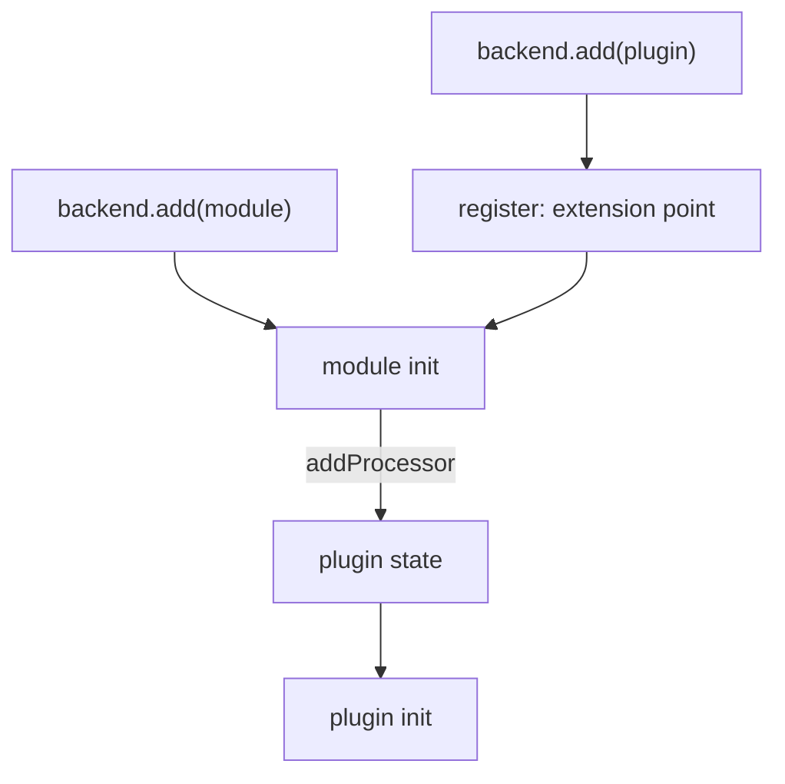

# Backend Modules, Extension Points And Compatibility

A backend plugin owns one feature. Sometimes an organization needs to change that feature in a way the plugin author did not ship: a custom processor for the catalog, a new action for the scaffolder, or a new source of data. Editing the plugin package is a bad answer, because every update of the package would overwrite the change. Backstage gives plugins a supported way to be extended, and this part explains it: extension points, backend modules and the rules for matching versions.

## Extension points

An extension point is an interface that a plugin publishes so that other code can customize it. The plugin creates the extension point with `createExtensionPoint` from `@backstage/backend-plugin-api`, and gives it an identifier. The extension point lives in a small library package, usually named `plugin-<pluginId>-node`, so that modules can import it without importing the whole plugin.

The playground catalog plugin uses `catalogProcessingExtensionPoint` from `@backstage/plugin-catalog-node`. Through it, a module can add a processor, which is code that reads and changes entities while the catalog processes them. The plugin implements the extension point in its `register` function with `env.registerExtensionPoint(ref, implementation)`. A plugin you write yourself follows the same shape:

```ts
export const beaconSourcesExtensionPoint =
  createExtensionPoint<BeaconSourcesExtensionPoint>({
    id: 'beacon.sources',
  });
```

## Backend modules

A backend module is a package that extends exactly one plugin. It is created with `createBackendModule` from `@backstage/backend-plugin-api`, and it has two identifiers: the `pluginId` of the plugin it extends and its own `moduleId`. Read the module in the playground.

<!-- astrona:playground:renew -->

```sh
cd ~/backstage-app
cat plugins/catalog-backend-module-outpost/src/module.ts
```

The module declares `pluginId: 'catalog'` and `moduleId: 'outpost-entities'`. Its `deps` list the extension point `catalogProcessingExtensionPoint` next to the `logger` service. In `init`, it receives the extension point implementation and calls `catalog.addProcessor(new OutpostProcessor())`. The processor class is in a separate file in the same package.

A module is installed like a plugin: with `backend.add(import('...'))` in the backend index. It must be installed in the same backend as the plugin it extends. Check which lines do this:

```sh
grep -n "backend.add" packages/backend/src/index.ts
```

The output lists one line per package, including the catalog plugin and the outpost module.

## The initialization order

The order matters. Backstage initializes all modules of a plugin completely before it initializes the plugin itself. The plugin creates its internal state in `register`, exposes the extension point and waits. The modules run their `init` and call the extension point. Then the plugin `init` runs and reads everything the modules added. This is why a plugin can safely build its router or processing pipeline from the collected values in its own `init`.

A module that tried to call an extension point later, for example from a timer, would run after the plugin had already started. The extension point contract is only valid during module initialization.



The diagram shows the plugin registering its extension point first, the module filling it, and the plugin starting last.

## Supported contracts, not private files

A module may only use what the plugin publishes: extension points and the services of the backend. It must not import files from inside the plugin package by path, such as `@backstage/plugin-catalog-backend/src/...`. A path import can work today and break after an update, because the file was never a public interface. The `-node` package and the package entry point are the public surface. If a plugin has no extension point for what you need, the right step is to ask for one, not to reach into private code.

## Several modules and several plugins

A plugin can have many modules, and each module is independent. Two modules that both add a processor are both used. A module can depend on more than one extension point, and on any core service. A module belongs to one plugin only. If one customization must touch two plugins, it needs two modules, one for each plugin, and each uses that plugin's contract.

## Architecture-version compatibility

Backstage has gone through two backend designs and two frontend designs. A feature must match the design of the app that installs it. Three things tell you which design a backend uses.

First, the backend index. The new backend system has `createBackend()` from `@backstage/backend-defaults` and `backend.add(import('...'))` lines. The old system has a long `index.ts` that creates an `env` object for each plugin and mounts routers by hand, with files in `packages/backend/src/plugins`.

Second, the plugin package. A new-system plugin has a default export made with `createBackendPlugin`. An old-system plugin exports a `createRouter` function, and the app author writes the glue code. Some packages publish both. The installation guide of the package says which entry to use.

Third, the extension mechanism. In the old system, customization usually means editing the glue code, such as `CatalogBuilder` in `plugins/catalog.ts`. In the new system it means adding a module. A guide that tells you to edit `plugins/catalog.ts` was written for the old system, and a guide that says `backend.add(import('...module...'))` was written for the new one.

Mixing designs fails in different ways. Old-style glue code in a new backend is not loaded at all, because nothing calls it. A new-style package added to an old backend is never started, because the old backend has no `backend.add`. Check the design of the app first, then choose the matching code. Backstage documents a migration path from the old backend to the new one.

## Checking a frontend and a backend together

A feature with both parts has two compatibility questions. The frontend might be the legacy or the new system, and the backend might be the old or the new system. The two choices are independent, because the browser and the server only share an HTTP API and the plugin id. Check each side separately and then check that the ids match.

```sh
grep -n "createApp" packages/app/src/App.tsx
grep -n "createBackend" packages/backend/src/index.ts
```

The first line shows which frontend `createApp` the app imports. The second shows that the backend uses the new system.

You can now describe how a backend plugin is customized without changing its code, in what order the pieces start, and how to match code to the design of the app. These ideas together separate what belongs in the browser from what belongs on the server.

## Common pitfalls

> [!WARNING]
> Install a module in the same backend as its plugin, with its own `backend.add` line. Import extension points from the public `-node` package, never from a `src` path inside another package. Add the `-node` library only as a dependency, not with `backend.add`, because it is neither a plugin nor a module. Check whether the app uses the old or the new backend before you follow an installation guide.
