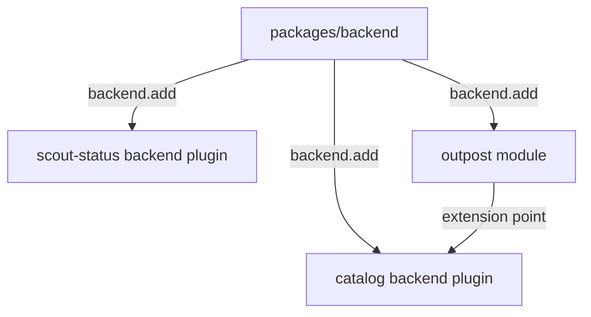

# Backend Plugins, Modules, Services And Extension Points

This module explains the server half of a Backstage feature. A backend plugin runs in the Node.js backend process, where it can keep credentials, call private systems and enforce permissions. The module shows how the new backend system loads plugins, how a plugin receives services, how a backend module extends a plugin through an extension point, and how to match code to the version of the architecture an app uses.

The examples use a backend plugin named `scout-status` that answers the request of the frontend page, and a backend module named `outpost-entities` that extends the catalog plugin. The playground holds both in a small repository.

## Learning Goals

- Explain what `createBackend`, `backend.add(import('...'))`, `createBackendPlugin` and `createBackendModule` do.
- Show how the plugin id decides the URL path and how the frontend finds it with the discovery API.
- Name the main entries of `coreServices` and explain dependency injection with `deps` and `init`.
- Explain extension points, backend modules and the order in which they initialize.
- Tell the old backend design from the new one and the legacy frontend from the new frontend system, and explain why they are chosen separately.
- Say why a secret belongs in a backend plugin and not in a frontend plugin.

## Before You Start

You should know that a Backstage app has a frontend package and a backend package, and what an HTTP request is. You do not need to write TypeScript beyond reading short files. The hands-on steps use a terminal in a virtual machine with `grep`, `cat` and `nano`. Nothing is built or started. Terms are defined where they first appear.

## Words used in this module

| Term | Meaning |
| --- | --- |
| Backend plugin | A package that runs on the server and provides one feature, such as an HTTP API |
| Backend module | A package that extends one backend plugin through its extension points |
| Plugin id | The unique name of a plugin; it decides the URL path `/api/<pluginId>` |
| Service | A shared facility that the backend creates and gives to plugins, such as a logger |
| `coreServices` | The object with the references of the services every backend has |
| Dependency injection | The backend passes the services a plugin asks for into its `init` function |
| Extension point | An interface that a plugin publishes so that modules can customize it |
| Node library | A `-node` package that holds extension points and shared types |
| Discovery | The service that returns the base URL of a plugin by its id |

## What the hands-on work covers

In the playground you read the backend index, the plugin and its router, and the catalog module. You trace the plugin id from the backend to the frontend call. You list which services the plugin asks for and which configuration it can read. You check the `backend.add` lines and relate them to the packages in the repository.

The graded lab after the last reading uses a project in which the backend plugin has the wrong id, no router, and the module has a private import and no extension point. You fix both packages, add them to the backend and add the dependencies.

## The three readings

The first reading explains the new backend system and how a plugin becomes reachable. The second explains core services and dependency injection. The third explains extension points, modules, the initialization order and compatibility between architecture versions.

## How to work

Each reading has at most about eight commands. Read the paragraph before each command, run it and compare the result with the explanation. The commands only read files. If you change a file, you can read the original again in a fresh playground.

The playground is renewed at the start of each hands-on reading so that you have the full time available. It is removed at the end of the summary.

## The project you will read

```text
app-config.yaml
packages/backend/src/index.ts
packages/backend/package.json
plugins/scout-status-backend/src/index.ts
plugins/scout-status-backend/src/plugin.ts
plugins/scout-status-backend/src/router.ts
plugins/catalog-backend-module-outpost/src/index.ts
plugins/catalog-backend-module-outpost/src/module.ts
plugins/catalog-backend-module-outpost/src/OutpostProcessor.ts
```



The diagram shows that the backend loads three packages and that the module extends the catalog plugin through an extension point.

## Limits of what this module claims

The new backend system is the one that current Backstage documents. Package names and exports can change between releases, so check the documentation for the version in your own app before you copy code.

## Reading Order

1. Backend Plugins And The New Backend System
2. Core Services And Dependency Injection
3. Backend Modules, Extension Points And Compatibility
4. Summary

<!-- astrona:playground -->
