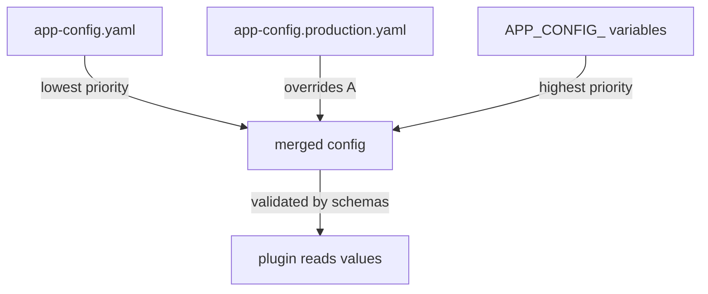

# How Backstage Loads And Layers Configuration

A plugin author cannot know the host name of your database, the address of your `scout` service or the token that protects it. Those values differ in every installation and in every environment. Backstage solves this with configuration files that it loads when a process starts. This chapter explains which files it loads, which file wins when two files set the same key, and how a value can come from the environment instead of from the file.

## The files and their order

Backstage reads **configuration** (the settings of an installation, written in YAML) when the backend or the frontend build starts. With no `--config` flag, it loads `app-config.yaml` from the repository root and, when the file exists, `app-config.local.yaml` next to it. The local file is for one developer's machine and is normally ignored by git. Values in `app-config.local.yaml` win over values in `app-config.yaml`.

When you pass one or more `--config` flags, Backstage stops loading the two default files. It loads only the files you list. A production start command therefore names every file on purpose, for example `--config app-config.yaml --config app-config.production.yaml`. Among `--config` files, the last flag has the highest priority. Environment variables whose names start with `APP_CONFIG_` rank above all files.



The diagram shows the order of precedence for a production start. The merged result is what the plugin code sees, and the schemas check it before any plugin reads it.

## Merge rules

The merge is not a simple copy of the last file. Objects merge key by key, so a production file can set only `scoutStatus.refreshSeconds` and keep every other `scoutStatus` key from the base file. Primitive values (strings, numbers and booleans) are replaced. Arrays are replaced as a whole: if the base file lists three items and the production file lists one, the result has one item, not four.

A `null` value is different from a missing key. A key set to `null` in a higher-priority file means "explicitly absent", and the read does not fall back to the value in a lower file. Use it only when you really want to remove a setting.

Look at the base file in the playground. Start in the repository and print the plugin block:

<!-- astrona:playground:renew -->

```sh
cd ~/backstage-app
grep -n -A6 '^scoutStatus' app-config.yaml
```

The output is the `scoutStatus` block of the base file. It has `apiUrl`, `apiToken`, `refreshSeconds` and `title`. Now print the production file:

```sh
cat app-config.production.yaml
```

The production file sets `app.baseUrl` and `scoutStatus.refreshSeconds` only. With both files loaded in the order above, `refreshSeconds` comes from the production file and `title` comes from the base file. This is the object merge at work.

The loader also works relative to the process, not to the file. Relative `--config` paths resolve from the working directory of the process that starts Backstage. A start command that works from the repository root can therefore fail when a container starts it from another directory. Use paths that you have tested in the same place where production runs.

## Environment substitution

Putting a token in a file that is committed to git is a leak. Backstage supports **substitution**: a string value may contain `${NAME}`, and the loader replaces it with the value of the environment variable `NAME` at startup. If the variable is not set, the whole value becomes `undefined`, so a required read fails with a clear error. You can give a fallback with `${NAME:-default}`, which uses the default when the variable is unset or empty. To write a literal `${` in a value, write `$${`.

Here is a base file that uses both forms. Save this as `app-config.scout.yaml`:

```yaml
scoutStatus:
  apiUrl: ${SCOUT_API_URL:-http://localhost:9090/status}
  apiToken: ${SCOUT_API_TOKEN}
```

The first value works on a laptop with no variable set. The second value has no default, so a start without `SCOUT_API_TOKEN` fails when the backend reads it, which is what you want for a secret. Check that both lines are in the file with `grep`:

```sh
grep -n 'SCOUT_API' app-config.scout.yaml
```

The command prints both lines with their line numbers. Nothing has loaded this extra file yet, because the loader reads only the files named with `--config` or the two defaults.

## Includes: $env, $file and $include

Substitution works inside one string. **Includes** replace a whole value. A key that starts with `$` tells the loader to fetch the value from somewhere else, and it does this once at startup.

- `$env: SCOUT_API_TOKEN` reads the value of an environment variable.
- `$file: ./scout-token.txt` reads the whole content of a text file. The path is relative to the config file that contains the key.
- `$include: ./secrets.yaml#scoutStatus.apiToken` loads a `.json`, `.yml` or `.yaml` file. The part after `#` picks one value by dot-separated keys.

`$file` fits container platforms that mount secrets as files. `$env` fits platforms that inject environment variables. Both keep the secret out of git. You can combine includes and substitution, for example `$include: secrets.${BACKSTAGE_ENVIRONMENT}.yaml`.

A last habit helps with debugging. When a value looks wrong, ask which file set it last. Check the order of the `--config` flags first, then check for an `APP_CONFIG_` variable in the environment, because those variables rank above every file and are easy to forget.

## What you now know

Backstage loads `app-config.yaml` and `app-config.local.yaml` by default, or only the files you name with `--config`. Later files win, objects merge, and arrays and primitives are replaced. Substitution and `$env`, `$file` and `$include` keep secrets and environment-specific values out of committed files. One question remains: what stops a plugin from reading a key that does not exist, or from sending a secret to the browser? A configuration schema answers it.

## Common pitfalls

> [!WARNING]
> Passing any `--config` flag turns off the automatic loading of `app-config.local.yaml`. A start command that lists only the production file silently drops the base file, so every setting that lived only in the base file is missing.

> [!WARNING]
> Arrays do not merge. A production override that lists one entry in an array replaces the whole array from the base file. Repeat every item you want to keep.
