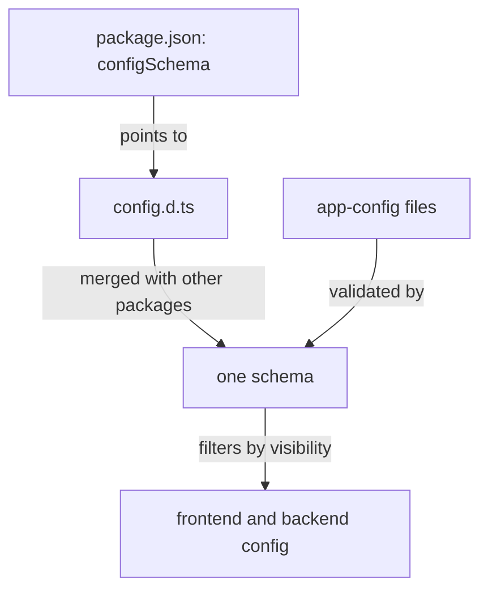

# Declaring A Configuration Schema In config.d.ts

A configuration file is plain text, and plain text has no types. Without a schema, a plugin can read a key that nobody documented, a typo in a key name goes unnoticed, and a secret can end up in the browser. Backstage adds a **configuration schema**: a description of the keys a package reads, their types and who may see them. This chapter shows how a plugin declares its schema and what the three visibility levels do.

## Where the schema lives

A package declares its schema in one place, the top-level `configSchema` field of its `package.json`. The value is either an inline JSON Schema object or a relative path to a `.json` file or a `.d.ts` file. Most plugins use a TypeScript declaration file named `config.d.ts`. The file exports one interface named `Config`. When the schema is a file, the package must also list the file in the `files` field, otherwise the file is not published and the schema is lost when the plugin is installed from a registry.

Here is the `package.json` fragment that registers a schema:

```json
{
  "files": ["dist", "config.d.ts"],
  "configSchema": "config.d.ts"
}
```

When the Backstage CLI builds the app or the backend, it collects the schema of every installed package, merges them into one schema and validates the merged configuration against it. A key with the wrong type, such as `refreshSeconds: "soon"` where a number is declared, stops the start with an error that names the key.



The diagram shows that the schema both validates the merged files and decides which values each side may see.

## Writing the interface

Open the schema of the playground plugin:

<!-- astrona:playground:renew -->

```sh
cd ~/backstage-app/plugins/scout-status
cat config.d.ts
```

The file declares an `export interface Config` with a `scoutStatus` object. A key marked with `?` is optional, and a key without it is required. A JSDoc comment above a key (the `/** ... */` block) can hold a description and a visibility tag. Descriptions show up in tooling and in validation errors, so write them.

A complete schema for the plugin looks like this:

```ts
export interface Config {
  scoutStatus?: {
    /** Base URL of the scout status API. */
    apiUrl: string;
    /**
     * Token for the scout status API.
     * @visibility secret
     */
    apiToken: string;
    /**
     * Seconds between refreshes.
     * @visibility frontend
     */
    refreshSeconds?: number;
    /**
     * Card title.
     * @visibility frontend
     */
    title?: string;
  };
}
```

The whole `scoutStatus` block is optional, so an installation that does not use the plugin does not need to set it. Inside the block, `apiUrl` and `apiToken` are required.

## The three visibility levels

**Visibility** says which side of the application may read a key. It is set with `@visibility` on one key, or with `@deepVisibility` on a key and everything below it.

- `backend` is the default. Only backend code sees the value. Browser code does not.
- `frontend` makes the value visible to the browser as well as the backend. Backstage includes it in the configuration that it embeds in the served frontend bundle.
- `secret` is backend only, like the default, and marks the value as sensitive so that tools can leave it out of logs.

The default matters. A key with no tag is not exposed to the browser, so a missing tag fails safe: the frontend cannot read it, and you notice when you test. The opposite mistake is dangerous. Marking `apiToken` as `frontend` sends the token to every visitor. Check each `frontend` tag by asking: would I paste this value into a public web page?

Find the tags in the playground file with `grep`:

```sh
grep -n '@visibility' config.d.ts
```

If the plugin schema has no tag at all, the command prints nothing, and every key is backend only. That means the frontend card cannot read `title` or `refreshSeconds` yet.

## Merge conflicts and runtime effects

Backstage merges the schemas of all packages. Two packages may declare the same key only if their declarations agree. If one package says a key is `frontend` and another says `secret`, the merge fails at startup. Pick one owner for each key.

Visibility is applied by the build and by the server, not by your component. A frontend component that calls `getString('scoutStatus.apiToken')` throws at run time because that key is filtered out of the browser configuration. The error appears in the browser, not at compile time, since TypeScript does not know about visibility.

## What you now know

A package registers `config.d.ts` through `configSchema` and `files`. The `Config` interface declares keys, types and optionality, and `@visibility` controls what reaches the browser. The default is backend only, and `secret` marks sensitive values. What remains is the code that reads the values: how a backend plugin gets the configuration object, and how a React component gets it.

## Common pitfalls

> [!WARNING]
> Adding `config.d.ts` without adding `"configSchema": "config.d.ts"` and the file name in `files` has no effect. The schema is ignored, and nothing validates or filters the keys.

> [!WARNING]
> Marking a token or password `@visibility frontend` publishes it to every browser that loads the app. Use `secret` or leave the default.
