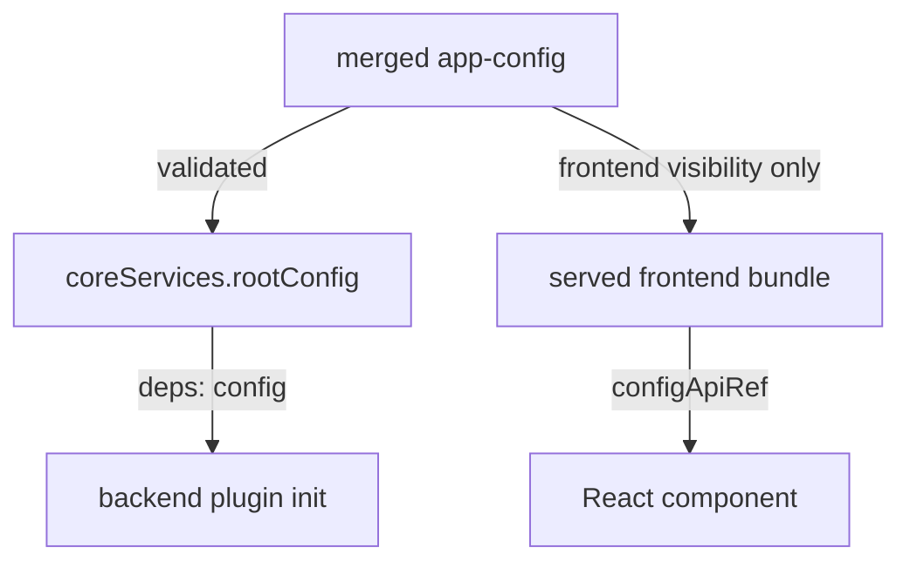

# Reading Configuration In Backend And Frontend Plugins

Files and schemas only matter when code reads the values. Backend and frontend code read them in different ways, and the difference is a common source of bugs. This chapter shows the exact calls on both sides, how to choose between a required and an optional read, and how to give a plugin sensible defaults so a missing setting does not break it.

## The Config object

Both sides read configuration through the same type, `Config`, from the package `@backstage/config`. It offers read methods that take a dot-separated key. `getString` reads a required string and throws if the value is missing or not a string. `getOptionalString` returns `undefined` when the key is missing, and it still throws when the value has the wrong type. `getOptionalNumber` does the same for numbers. `getConfig` returns a nested view, so `config.getConfig('scoutStatus').getString('apiUrl')` reads the same value as `config.getString('scoutStatus.apiUrl')`. `keys` lists the child keys of an object.

The rule for choosing is simple. Use a required read for a value without which the plugin cannot work, so a missing value fails at startup with a clear message. Use an optional read with `??` for a value that has a safe default.

## Backend: coreServices.rootConfig

In the new backend system a plugin asks for the configuration object as a **service dependency** (a named object that the backend creates and passes to your code). The service for configuration is `coreServices.rootConfig`, from `@backstage/backend-plugin-api`. You list it in `deps` and receive it in `init`. Open the playground plugin:

<!-- astrona:playground:renew -->

```sh
cd ~/backstage-app/plugins/scout-status-backend
cat src/plugin.ts
```

The file creates the plugin with `createBackendPlugin`. A correct version reads the settings like this:

```ts
import {
  coreServices,
  createBackendPlugin,
} from '@backstage/backend-plugin-api';

export const scoutStatusPlugin = createBackendPlugin({
  pluginId: 'scout-status',
  register(env) {
    env.registerInit({
      deps: {
        logger: coreServices.logger,
        config: coreServices.rootConfig,
        httpRouter: coreServices.httpRouter,
      },
      async init({ logger, config, httpRouter }) {
        const apiUrl = config.getString('scoutStatus.apiUrl');
        const apiToken = config.getString('scoutStatus.apiToken');
        const refreshSeconds =
          config.getOptionalNumber('scoutStatus.refreshSeconds') ?? 30;
        logger.info(`scout-status refreshes every ${refreshSeconds}s`);
      },
    });
  },
});
```

The backend reads the merged, validated configuration, including `secret` and `backend` keys. The plugin never reads `process.env` itself. If it did, it would bypass the files, the schema and the layering, and an operator could not predict the value from the configuration files.



The diagram shows two paths from the same files: the backend gets everything, and the browser gets only the keys tagged `frontend`.

## Frontend: configApiRef and useApi

A React component reads configuration through the **Utility API** system. An API reference named `configApiRef`, from `@backstage/core-plugin-api`, identifies the configuration API. The hook `useApi` returns the implementation. Print the component:

```sh
cd ~/backstage-app/plugins/scout-status
grep -n 'configApiRef\|useApi\|config\.' src/components/ScoutStatusCard.tsx
```

The matching lines show how the card reads its settings. A correct card looks like this:

```tsx
import { configApiRef, useApi } from '@backstage/core-plugin-api';

export const ScoutStatusCard = () => {
  const config = useApi(configApiRef);
  const title = config.getOptionalString('scoutStatus.title') ?? 'Scout Status';
  const refreshSeconds =
    config.getOptionalNumber('scoutStatus.refreshSeconds') ?? 30;
  return <div>{title} refreshes every {refreshSeconds}s</div>;
};
```

The card never reads `scoutStatus.apiToken`. That key is filtered out of the browser configuration, and a call to `getString` on it throws. The card also does not call the `scout` API with a token. A backend route calls the API with the token and returns only the result, so the secret stays on the server.

## Settings for the new frontend system

An application built on the new frontend system has a second, built-in place for settings. Under `app.extensions` in `app-config.yaml`, each entry is an extension ID with optional `config`, `disabled` and `attachTo` fields. A page extension accepts a `path` in its `config`. This is configuration of an extension and not of your own plugin keys: your own keys, such as `scoutStatus.title`, still go through `configApiRef`.

## Plugin options and defaults

A plugin that needs a setting has three layers. The first is the value in the configuration files. The second is a default in code, written with `?? 30`. The third is the schema, which documents the type. Keep the three in step: when you add a key, add it to the schema, give it a default or make it required, and describe it in a comment. Do not hide required values behind defaults that only work on a laptop, such as `http://localhost`, because a production start would use that default without any warning.

## What you now know

The backend reads configuration through `coreServices.rootConfig` and the `Config` methods. The frontend reads it with `useApi(configApiRef)` and sees only `frontend` keys. Required reads fail early, and optional reads with `??` supply defaults. The open question is how to change what a plugin does when no setting exists for it, which needs an extension point.

## Common pitfalls

> [!WARNING]
> Reading `process.env` inside a plugin skips the configuration system. The value cannot be validated, layered or documented, and operators cannot find it in the files.

> [!WARNING]
> A frontend component that reads a `secret` or default-visibility key throws at run time. Read such values in the backend and return only the result to the browser.
