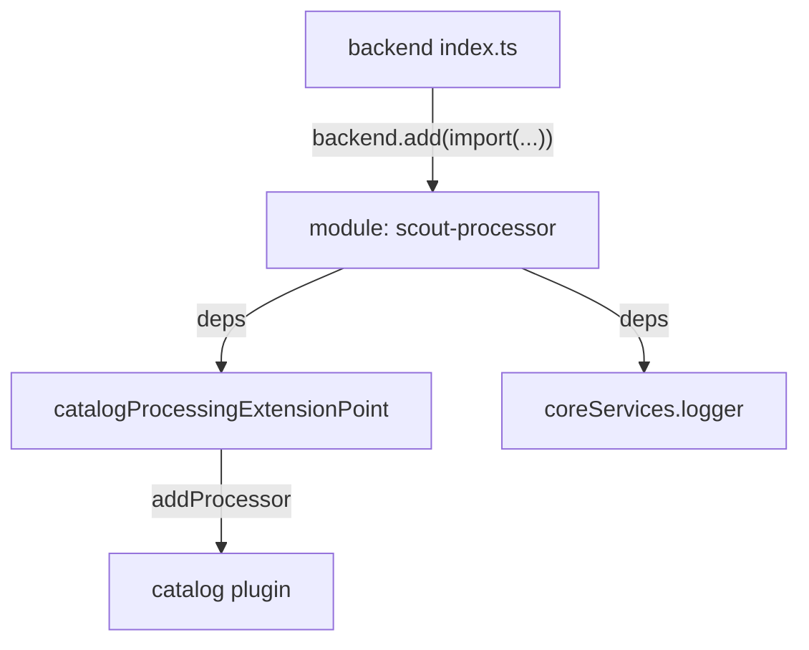

# Extending Backend Plugins With Modules And Extension Points

The `catalog` backend plugin builds the software catalog from many sources. Teams often need to add one more step, for example a check that every `Component` entity carries an annotation. The plugin cannot offer a setting for every such step. Instead it publishes **extension points**: typed interfaces through which other code may add behavior. This chapter shows how a backend module uses an extension point, why that is safer than editing the plugin, and how the module reaches the running backend.

## Plugins, modules and extension points

In the new backend system, a **backend plugin** is a feature with its own `pluginId`, created with `createBackendPlugin`. A **backend module** extends exactly one plugin and is created with `createBackendModule`. It declares the `pluginId` of its target and its own `moduleId`. An **extension point** is an object that a plugin registers so that modules can ask for it in `deps`. The catalog, for example, offers `catalogProcessingExtensionPoint` from `@backstage/plugin-catalog-node`, which has methods such as `addProcessor`.

The module receives the extension point in the same way it receives a service: through `deps` in `registerInit`. The backend starts the target plugin and the modules in the right order, and it passes each module only the interfaces it asked for. A module cannot reach the private state of the plugin, and the plugin does not need to know which modules exist.



The diagram shows that the module depends on the extension point and a service, and that `index.ts` is what loads the module.

## A processor and the module that adds it

A **catalog processor** is code that runs inside the catalog processing loop for each entity. Open the module in the playground:

<!-- astrona:playground:renew -->

```sh
cd ~/backstage-app/plugins/catalog-backend-module-scout
cat src/module.ts
```

A correct module has this shape:

```ts
import {
  coreServices,
  createBackendModule,
} from '@backstage/backend-plugin-api';
import { catalogProcessingExtensionPoint } from '@backstage/plugin-catalog-node';
import { ScoutProcessor } from './ScoutProcessor';

export const catalogModuleScoutProcessor = createBackendModule({
  pluginId: 'catalog',
  moduleId: 'scout-processor',
  register(env) {
    env.registerInit({
      deps: {
        catalog: catalogProcessingExtensionPoint,
        logger: coreServices.logger,
      },
      async init({ catalog, logger }) {
        catalog.addProcessor(new ScoutProcessor(logger));
      },
    });
  },
});
```

The `pluginId: 'catalog'` line is what ties the module to the catalog. A wrong `pluginId` names a different plugin, so the module does not extend the catalog. The extension point goes in `deps` under any local name, here `catalog`, and `init` receives it under the same name.

## The package entry point

The backend loads a module by importing its package and using the default export. The module package therefore exports the module as `default` in `src/index.ts`:

```ts
export { catalogModuleScoutProcessor as default } from './module';
```

Print the entry file to check it:

```sh
cat src/index.ts
```

If the file has no `default` export, `backend.add(import('...'))` receives a module with nothing to add, and the backend cannot find a feature.

## Registering the module in the backend

Writing the module does nothing until the backend adds it. The file `packages/backend/src/index.ts` creates the backend with `createBackend()` and lists features with `backend.add(import('package-name'))`. Look at the lines:

```sh
cd ~/backstage-app
grep -n 'backend.add' packages/backend/src/index.ts
```

Each line adds one plugin or module. The module line looks like this:

```ts
backend.add(import('@internal/backstage-plugin-catalog-backend-module-scout'));
```

The `import()` is a dynamic import, so the backend loads the package when it starts. A line that is commented out with `//` adds nothing, which is the most common reason that a finished module has no effect.

## Why this beats editing the plugin

An extension point is a public contract. The catalog team promises that `addProcessor` keeps working across releases and announces changes in release notes. Code inside the catalog package has no such promise. A module that depends on `catalogProcessingExtensionPoint` and `coreServices.logger` needs only those two interfaces, so an upgrade of the catalog rarely breaks it. If an extension point does not give you what you need, ask upstream or write a smaller change; do not reach into the plugin.

## What you now know

A backend module names its target `pluginId` and its own `moduleId`, receives extension points and services in `deps`, and does its work in `init`. The package exports the module as `default`, and `backend.add(import(...))` in the backend `index.ts` loads it. The catalog now runs your processor, so the next question is how to change what the browser shows and who is allowed to act.

## Common pitfalls

> [!WARNING]
> A module with the wrong `pluginId`, a missing `default` export or a commented-out `backend.add` line does nothing, and no error says so. Check all three when a module has no effect.

> [!WARNING]
> Do not import code from another plugin's `src` folder to avoid an extension point. That couples you to private structure that can change in any release.
