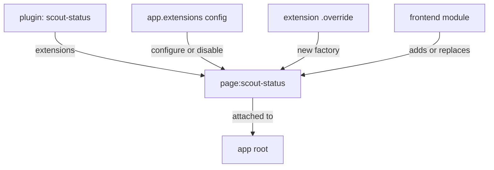

# Overriding Frontend Extensions Without Forking

The browser side of Backstage needs the same discipline as the backend. A team wants the `scout-status` page at `/fleet-status` instead of `/scout-status`, or wants to replace one card with its own. Copying the plugin to change one line gives you a second copy of the code to maintain. The new frontend system offers three supported levels of change, from smallest to largest: configuration, an override of one extension, and a module that adds or replaces extensions. This chapter shows each level and how to pick one.

## Plugins, extensions and blueprints

In the new frontend system, which uses the package `@backstage/frontend-plugin-api`, a frontend plugin is created with `createFrontendPlugin`. It has a `pluginId` and a list of **extensions**. An extension is one piece of the app, such as a page, a navigation item or an entity card. Each extension has an ID, for example `page:scout-status`, and it attaches to a parent extension. A **blueprint** is a helper that creates a common kind of extension: `PageBlueprint.make` creates a page from a `path` and a `loader` function.

The app collects all plugins, builds a tree of extensions from them, and renders the tree. Configuration, overrides and modules all act on that tree. This is why you can change one extension without changing the plugin package.



The diagram shows three ways to change the same extension, and none of them edits the plugin package.

## Level 1: configure or disable in app-config.yaml

The smallest change needs no code. The `app.extensions` list in `app-config.yaml` configures any extension by ID. Each entry may set `config`, `disabled` and `attachTo`. Page extensions accept a `path` in `config`. Look at the list in the playground:

<!-- astrona:playground:renew -->

```sh
cd ~/backstage-app
grep -n -A12 'extensions:' app-config.yaml
```

A configuration that moves the page looks like this:

```yaml
app:
  extensions:
    - page:scout-status:
        config:
          path: /fleet-status
```

`app.extensions` must be an array, so every item starts with a dash. Writing an entry as `- <extension-id>: false` disables that extension, and a bare ID enables it. Use this level first, because it survives upgrades best: the plugin declares which settings it accepts.

## Level 2: override one extension

When the setting you need does not exist, you can override the extension. Every extension has an `override` method that returns a new extension, and the original stays unchanged. The `factory` receives the original factory so that you can call it with changed parameters:

```ts
const fleetStatusPage = scoutStatusPlugin
  .getExtension('page:scout-status')
  .override({
    factory: originalFactory =>
      originalFactory({ path: '/fleet-status' }),
  });
```

The override keeps everything the original does and changes one parameter. You hand the result to the plugin through `withOverrides`, which merges the new extensions with the original ones:

```ts
export default scoutStatusPlugin.withOverrides({
  extensions: [fleetStatusPage],
});
```

Use `withOverrides` whenever you override or add extensions for a plugin. Print the app entry to see which plugins it installs:

```sh
cat packages/app/src/App.tsx
```

## Level 3: a frontend module

A **frontend module** adds or replaces extensions for a plugin that someone else owns. It is created with `createFrontendModule`, which needs the `pluginId` of the target plugin, and the target plugin must be installed for the module to load:

```ts
import {
  PageBlueprint,
  createFrontendModule,
} from '@backstage/frontend-plugin-api';

const fleetPage = PageBlueprint.make({
  params: {
    path: '/fleet-status',
    loader: () =>
      import('./FleetStatusPage').then(m => <m.FleetStatusPage />),
  },
});

export default createFrontendModule({
  pluginId: 'scout-status',
  extensions: [fleetPage],
});
```

The module supplies its own page and the app uses it. Choose a module when the change is larger than one parameter, for example a different component. The app lists modules in its `features`, next to the plugins it installs.

## Choosing the level

Ask three questions in order. Does the plugin already expose a setting for this? Use configuration. Does the change adjust one extension that exists? Use `.override`. Does the change add or replace a whole extension? Use a module. Each step down the list ties you more closely to the plugin's structure, and each needs more checking after an upgrade.

A visual override never changes server authority. Hiding a button removes a path in the interface, but a person who calls the backend directly is still subject only to what the backend checks. Permission rules belong in the backend.

## What you now know

Frontend plugins expose extensions with IDs. You configure or disable them in `app.extensions`, override one with `.override` and `withOverrides`, or replace and add them with `createFrontendModule`. The smallest level that works is the best. The remaining question is how to decide who may act, and how to keep all of this upgradable.

## Common pitfalls

> [!WARNING]
> `app.extensions` is a list, not a map. An entry written without the leading dash does not match the required list format.

> [!WARNING]
> Combining snippets from the legacy frontend system and the new one compiles in isolation but registers nothing. Check which system the app uses before you copy an example.
