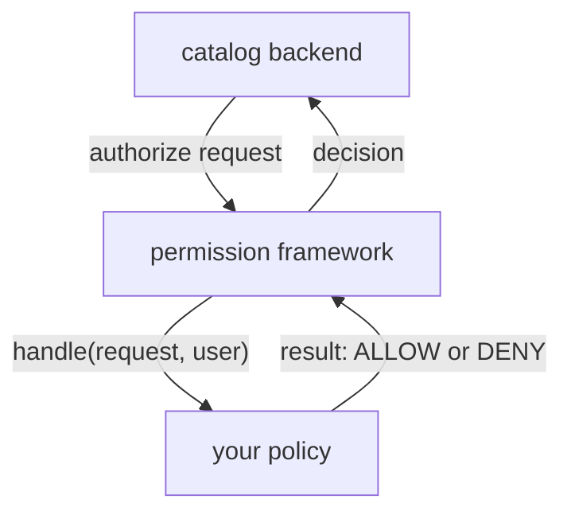

# Permission Policies, Compatibility And Upgrades

A hidden button is not a security control. Only the backend can decide whether a request is allowed, and in Backstage the permission framework asks one function for that decision: the permission policy. This chapter shows the contract of that function, how to register it as a backend module, and how to keep all your customizations upgradable. It ends with the cost of a private fork, so you can tell when one is justified.

## The permission contract

When a plugin backend wants to know whether a user may do something, it sends an authorization request to the permission framework. Each request carries a **permission**, which is a named action such as `catalog.entity.delete`. The framework calls your **permission policy**, a class that implements `PermissionPolicy` from `@backstage/plugin-permission-node`. The policy has one method:

```ts
async handle(
  request: PolicyQuery,
  user?: PolicyQueryUser,
): Promise<PolicyDecision>
```

`PolicyQuery` holds the `permission`. `PolicyQueryUser` describes the signed-in user and may be absent. The method returns a `PolicyDecision`, an object with a `result` field. The values come from `AuthorizeResult` in `@backstage/plugin-permission-common`: `ALLOW`, `DENY`, or `CONDITIONAL` for decisions that depend on the resource. The result is an object, so `return AuthorizeResult.DENY` without the braces breaks the contract.



The diagram shows that the plugin backend asks and the policy answers; the browser is not part of the decision.

## Writing a policy that denies by default

Open the policy in the playground:

<!-- astrona:playground:renew -->

```sh
cd ~/backstage-app/plugins/permission-backend-module-fleet-policy
cat src/policy.ts
```

A safe policy names what it restricts, and it answers explicitly for everything else. This one refuses entity deletion unless the user has the ownership reference `group:default/starfleet-admins`:

```ts
import { isPermission, AuthorizeResult } from '@backstage/plugin-permission-common';
import type { PolicyDecision } from '@backstage/plugin-permission-common';
import type {
  PermissionPolicy,
  PolicyQuery,
  PolicyQueryUser,
} from '@backstage/plugin-permission-node';
import { catalogEntityDeletePermission } from '@backstage/plugin-catalog-common/alpha';

export class FleetPolicy implements PermissionPolicy {
  async handle(
    request: PolicyQuery,
    user?: PolicyQueryUser,
  ): Promise<PolicyDecision> {
    if (isPermission(request.permission, catalogEntityDeletePermission)) {
      const refs = user?.info.ownershipEntityRefs ?? [];
      if (refs.includes('group:default/starfleet-admins')) {
        return { result: AuthorizeResult.ALLOW };
      }
      return { result: AuthorizeResult.DENY };
    }
    return { result: AuthorizeResult.ALLOW };
  }
}
```

The `isPermission` helper compares the request with one permission. The last line allows everything that the policy does not mention. That default is a decision for your organization: a stricter policy ends with `DENY`. A policy that ends with a bare `ALLOW` and has no `DENY` branch protects nothing.

## Registering the policy

The policy runs only when the permission backend uses it. A module for the `permission` plugin sets it through the policy extension point:

```ts
export const permissionModuleFleetPolicy = createBackendModule({
  pluginId: 'permission',
  moduleId: 'fleet-policy',
  register(env) {
    env.registerInit({
      deps: { policy: policyExtensionPoint },
      async init({ policy }) {
        policy.setPolicy(new FleetPolicy());
      },
    });
  },
});
```

The extension point `policyExtensionPoint` comes from the alpha export of `@backstage/plugin-permission-node`. The backend then lists both the permission backend and the module with `backend.add(import(...))`. Check what the backend adds:

```sh
cd ~/backstage-app
grep -n 'backend.add' packages/backend/src/index.ts
```

## Compatibility and upgrades

Every customization depends on a public contract: an extension point, an extension ID, a configuration key or a type. When Backstage releases a new version, any of these may change, and the release notes say which. Keep a short list of what each customization depends on and who owns it. That list tells you what to test after an upgrade.

Upgrade all `@backstage` packages together. The command `yarn backstage-cli versions:bump` moves every `@backstage` package to the latest release in the `main` line, and `--release` selects another release or the `next` line. The file `backstage.json` records the Backstage version of the installation. A mix of package versions from different releases causes errors that look unrelated to the cause. After a bump, check that every package.json asks for the same version of a shared package.

## Private forks

A fork copies a plugin into your repository and edits it. Sometimes no supported contract can meet an essential need, and a fork is the only option. The cost is permanent: you must apply security fixes, port upstream changes and test every upgrade yourself. Write down why extension was not enough and which team owns the fork. A fork without an owner becomes a dependency that nobody upgrades.

## What you now know

A permission policy implements `handle` and returns an object with a `result`. It denies explicitly and is registered through a `permission` module. Customizations stay upgradable when they use public contracts, when versions move together, and when each fork has an owner and a reason. 

## Common pitfalls

> [!WARNING]
> A policy with no `DENY` branch allows every action. Test the denied case, not only the allowed one.

> [!WARNING]
> Hiding a button or a menu item does not stop a request. Enforce the rule in the backend policy.
