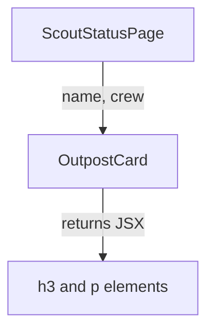

# JSX, Function Components And Props

A Backstage app is a React application, so every page, card and sidebar entry is a React component. Before you change one, you need to know what a component is, what JSX turns into, and how data from a parent reaches a child. This part builds that base with the `OutpostCard` component of the `scout-status` plugin.

## What a function component is

React (the JavaScript library that Backstage uses to build its user interface) describes a screen as a tree of components. A function component is a JavaScript function that receives one object, called props (short for properties), and returns a description of what to show. React calls the function each time it needs a new description. The function itself never touches the browser page directly.

The return value is written in JSX (JavaScript XML), a syntax that lets you write elements such as `<div>` inside TypeScript. The build tool in a Backstage app converts each JSX element into a normal function call. In a `.tsx` file this means the file contains both TypeScript types and JSX.

The starting `OutpostCard` shows one fixed outpost:

```tsx
import React from 'react';

export const OutpostCard = () => {
  return (
    <div>
      <h3>outpost-alpha</h3>
      <p>Crew: 12</p>
    </div>
  );
};
```

Component names start with a capital letter. React uses the capital letter to tell a component such as `<OutpostCard />` from a plain HTML element such as `<div>`. A lowercase name is looked up as an HTML tag, so `<outpostCard />` would not call your function.

## Props carry data from the parent

A fixed card is useless when the portal has many outposts. The parent component decides which outpost to show and passes that choice down as props. The child reads the values and shows them. The data flows in one direction, from parent to child, and the child must not change its props.

The following diagram shows the flow for the scout-status page.



The diagram shows that `ScoutStatusPage` owns the values and `OutpostCard` only turns them into elements.

In TypeScript you describe the props with an interface (a named list of fields and their types). Backstage plugins follow this pattern so the compiler can catch a missing or misspelled prop:

```tsx
export interface OutpostCardProps {
  name: string;
  crew?: number;
}
```

The question mark in `crew?: number` means the field is optional. A caller can leave it out, and then `crew` has the value `undefined` inside the component. The interface is honest about the data: some outposts have no recorded crew count.

## Rendering props and optional values

Curly braces in JSX switch from markup to a TypeScript expression. `{name}` inserts the value of `name`. An expression can be any value-producing code, such as a conditional:

```tsx
export const OutpostCard = ({ name, crew }: OutpostCardProps) => {
  return (
    <div>
      <h3>{name}</h3>
      <p>{crew === undefined ? 'Crew not recorded' : `Crew: ${crew}`}</p>
    </div>
  );
};
```

The parameter `{ name, crew }` is destructuring: it takes the two fields out of the props object. The conditional shows a clear text when the value is missing. Writing `crew!` (the non-null assertion) would silence the compiler but would still show `undefined` or crash later, because the assertion does not change the data.

Rendering must stay a calculation from props to JSX. The function can run many times, in any order React chooses. If the body sent a request or changed a global value, each extra run would repeat that action. Work that reaches outside the component belongs in an effect, a hook that runs after rendering.

## Check the files in the playground

Open the playground terminal. The commands below only read files, so you can run them in any order.

<!-- astrona:playground:renew -->

Move into the app and look at the card and its parent:

```sh
cd ~/backstage-app
cat plugins/scout-status/src/components/OutpostCard/OutpostCard.tsx
cat plugins/scout-status/src/components/ScoutStatusPage/ScoutStatusPage.tsx
```

The page file shows the parent that supplies the props. Search for every place that creates an `OutpostCard`:

```sh
grep -rn "<OutpostCard" plugins packages
```

Each result is a place where a parent passes props. When you add a required field to `OutpostCardProps`, every one of those lines needs the new prop. When you add an optional field, none of them has to change. This is the practical reason to choose between `crew: number` and `crew?: number` with care.

To try an edit, open the card with `nano`, change the text `Crew not recorded` to `Crew unknown`, and save with `Ctrl+O` and `Ctrl+X`. Then run `grep -rn "Crew" plugins` to confirm the change. The virtual machine does not build the app, so reading the file is the check.

## Children and composition

A component can also receive other elements between its tags. These arrive as the `children` prop. Backstage uses this for layout components such as `Page`, `Header` and `Content` from `@backstage/core-components`. `ScoutStatusPage` places `OutpostCard` inside `Content`, and `Content` shows whatever its children are.

```tsx
<Page themeId="tool">
  <Header title="Scout status" />
  <Content>
    <OutpostCard name="outpost-alpha" crew={12} />
  </Content>
</Page>
```

The `themeId` prop on `Page` selects a header color from the theme. `Header` takes the title as a prop. Composition means building a larger screen from small components with a clear job each, and passing data down through props.

Now you know that a component is a function from props to JSX, that the parent owns the data, and that an optional prop needs an explicit text for the missing case. The open question is what happens when a component must remember a value between renders, such as a counter, or must react to a value changing. That is the job of state and effects, which are hooks.

## Common pitfalls

> [!WARNING]
> Do not start a component name with a lowercase letter: React treats it as an HTML tag. Do not use `!` or `as` to hide an optional prop; show a text for the missing value. Do not change props inside the child, and do not send requests or change shared values in the body of the function.
