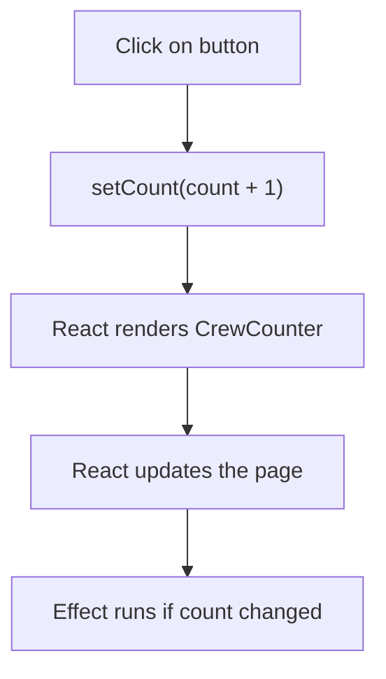

# State And Effects With Hooks

Props flow in from a parent, but some values belong to the component itself and change over time: the number of people on duty, the text in a search field, whether a panel is open. React keeps these values for the component, and it gives you hooks to read and change them. This part uses the `CrewCounter` component of the `scout-status` plugin to show how `useState` and `useEffect` work, what the dependency array does, and which rules keep hooks correct.

## State with useState

A hook is a function whose name starts with `use` and that connects a component to a React feature. `useState` stores one value for the component between renders. It returns a pair: the current value and a function that sets a new value.

```tsx
const [count, setCount] = useState(0);
```

The argument `0` is the initial value, used only on the first render. When code calls `setCount(count + 1)`, React stores the new value and calls the component function again. The new call sees the new `count`. React then compares the new JSX with the old JSX and changes only the parts of the page that differ.

State belongs to one component instance. Two `CrewCounter` elements on a page each have their own `count`. Props are different: they belong to the parent and arrive from outside.

## Effects with useEffect

Some work does not calculate JSX. Setting the browser tab title, starting a timer or sending a request are side effects: actions that reach outside the render calculation. `useEffect` runs a function after React has updated the page. The second argument, the dependency array, tells React when to run the function again.

The starting `CrewCounter` has an effect without that second argument:

```tsx
useEffect(() => {
  document.title = `${outpost}: ${count} on duty`;
});
```

Without a dependency array the effect runs after every render. That works for a tab title, but it hides the real relationship: the title depends on `outpost` and `count`. With the array the intention is explicit:

```tsx
useEffect(() => {
  document.title = `${outpost}: ${count} on duty`;
}, [outpost, count]);
```

React compares each listed value with its value from the previous render. If none changed, it skips the effect. The array must list every prop or state value that the effect function reads. If `outpost` is missing from the list, the tab title keeps the old outpost name after the parent passes a new one. This is a stale value: code that still uses an earlier snapshot.

The diagram below shows the order for one click on the counter button.



The diagram shows that the effect runs after the page update, not during the render calculation.

## An empty array and a cleanup function

An empty array, `[]`, means the effect has no dependencies and runs once after the first render. Use it only when the effect truly reads no props or state. An effect that starts a timer or a subscription returns a cleanup function. React calls the cleanup before the next run of the effect and when the component leaves the page:

```tsx
useEffect(() => {
  const timer = setInterval(() => setCount(value => value + 1), 1000);
  return () => clearInterval(timer);
}, []);
```

The functional form `setCount(value => value + 1)` reads the latest value from React instead of the value captured in the closure, so the empty array is safe here. Without the cleanup, a timer from a component that left the page would keep running.

## The rules of hooks

React remembers hook values by call order, not by name. The first `useState` call in a component gets the first stored slot, the second call gets the second slot. Two rules follow. Call hooks only at the top level of a component, never inside an `if`, a loop or a nested function. Call hooks only from function components or from other hooks. If a hook sits behind a condition, the order changes between renders and React gives a value to the wrong variable. The Backstage lint configuration includes the React hooks rules and reports both problems, including a missing dependency.

## Read the counter in the playground

<!-- astrona:playground:renew -->

Open the component and look at the three parts: the state, the effect and the returned button.

```sh
cd ~/backstage-app
cat plugins/scout-status/src/components/CrewCounter/CrewCounter.tsx
```

Find every hook call in the plugin and check each dependency list:

```sh
grep -rn "useState\|useEffect" plugins
grep -n "\], *\[\|}, \[" plugins/scout-status/src/components/CrewCounter/CrewCounter.tsx
```

The second command shows the line that closes the effect. In the playground the line reads `}, [outpost, count]);`. Open the file with `nano` and change the array to `[outpost]`. Now ask which value the effect reads that the array no longer lists. The answer is `count`, so the tab title would update for a new outpost but not for a new count. Change the array back to `[outpost, count]` before you leave the file.

The check you just did is the check a reviewer does: list the values the effect function reads, then compare that list with the array. The same check works for `useCallback` and `useMemo`, which use the same dependency rule.

## Deriving values instead of storing them

A beginner often copies a prop into state: `useState(crew)`. The state then keeps the first value and ignores later props. If a value can be calculated from props or other state during render, calculate it there. Keep state for values that the component changes itself. This keeps one source of truth and removes a class of bugs where two copies disagree.

You now know how a component remembers a value, how an effect reacts to a change and what the dependency array promises. The open question is how the page reaches users at all: a component that no route or sidebar item names never appears in the portal.

## Common pitfalls

> [!WARNING]
> Do not leave out the dependency array by accident: the effect then runs after every render. Do not leave out a value the effect reads, because the effect then works with a stale value. Do not call hooks inside conditions or loops. Do not copy a prop into state when you can calculate it during render.
