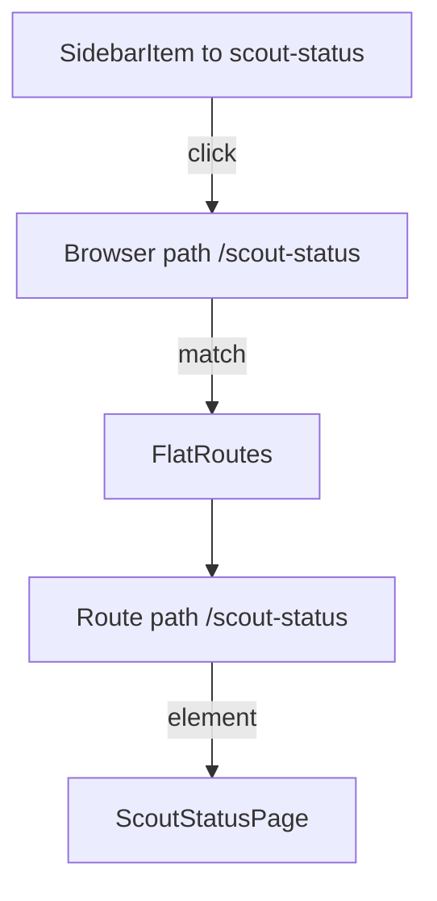

# Composing Pages In App.tsx, Routes And The Sidebar

A component becomes a feature only when a user can reach it. In a Backstage app two files decide that: `packages/app/src/App.tsx` registers the routes, and the sidebar component in `packages/app/src/components/Root/Root.tsx` lists the navigation entries. This part follows the `ScoutStatusPage` from the plugin to the browser address `/scout-status`, and explains which file does which job.

## How the app is assembled

`App.tsx` calls `createApp` from `@backstage/app-defaults` to build the app object. It then writes the routes as JSX inside `FlatRoutes`, a component from `@backstage/core-app-api`. `FlatRoutes` is a wrapper around the React Router `Routes` component. It compares the current browser path with each child `Route` and renders the element of the best match.

```tsx
const routes = (
  <FlatRoutes>
    <Route path="/" element={<Navigate to="catalog" />} />
    <Route path="/catalog" element={<CatalogIndexPage />} />
    <Route path="/scout-status" element={<ScoutStatusPage />} />
  </FlatRoutes>
);
```

Each `Route` has a `path` (the part of the address after the host name) and an `element` (the JSX to show). The page component comes from the plugin package. It must be imported at the top of the file:

```tsx
import { ScoutStatusPage } from '@internal/plugin-scout-status';
```

The package name `@internal/plugin-scout-status` is the `name` in `plugins/scout-status/package.json`. The workspace dependency in `packages/app/package.json` (`workspace:^`) links the app to that folder. The plugin's `src/index.ts` decides what the package exports. If `ScoutStatusPage` is not exported there, the import fails even when the file exists.

## Routes do not create sidebar entries

The route and the sidebar entry are two separate changes. The route makes the address work: typing `/scout-status` into the browser shows the page. The sidebar entry is only a link that points at an address. A route without a sidebar entry works but nobody finds it. A sidebar entry without a route links to an address that the app cannot match.

The sidebar lives in `Root.tsx`. It is built from components in `@backstage/core-components`:

```tsx
<SidebarPage>
  <Sidebar>
    <SidebarGroup label="Menu">
      <SidebarItem icon={HomeIcon} to="catalog" text="Home" />
      <SidebarItem icon={ExtensionIcon} to="scout-status" text="Scout status" />
    </SidebarGroup>
    <SidebarSpace />
  </Sidebar>
  {children}
</SidebarPage>
```

`SidebarPage` provides the layout, `Sidebar` holds the entries, `SidebarGroup` groups them under a label and `SidebarItem` is one link. A `SidebarItem` needs an `icon` (a component, not an element, so `icon={ExtensionIcon}`), a `to` path and a `text`. The `children` of `Root` are the routes from `App.tsx`, so the sidebar stays visible while the page content changes.

The following diagram shows the path from a click to the page.



The diagram shows that the sidebar only changes the address, and `FlatRoutes` decides which component renders.

## Where the legacy and the new frontend system differ

This app uses the legacy frontend system, where `App.tsx` lists routes by hand. Backstage also has a newer frontend system based on `@backstage/frontend-plugin-api`. There a plugin declares its page with `PageBlueprint` and the app discovers it, so there is no hand-written `Route` in `App.tsx`. The editing rule is the same: find out which system the app uses before you change the wiring. In the legacy system you edit the routes and the sidebar; in the new system you change the plugin's extensions or the app configuration.

## Make the change in the playground

<!-- astrona:playground:renew -->

The playground holds the finished wiring. Look at it first:

```sh
cd ~/backstage-app
grep -n "ScoutStatusPage\|Route" packages/app/src/App.tsx
grep -n "SidebarItem" packages/app/src/components/Root/Root.tsx
cat plugins/scout-status/src/index.ts
```

Now practise the full path with a second page. Open `plugins/scout-status/src/components/ScoutStatusPage/ScoutStatusPage.tsx` with `nano`, copy the file to a new component folder and name the new export `SupplyPage`:

```sh
mkdir plugins/scout-status/src/components/SupplyPage
cp plugins/scout-status/src/components/ScoutStatusPage/ScoutStatusPage.tsx plugins/scout-status/src/components/SupplyPage/SupplyPage.tsx
nano plugins/scout-status/src/components/SupplyPage/SupplyPage.tsx
```

In the copy, rename `ScoutStatusPage` to `SupplyPage` and set the header title to `Supplies`. Then follow the chain in order: add `export { SupplyPage } from './components/SupplyPage';` to `plugins/scout-status/src/index.ts` (create `components/SupplyPage/index.ts` with the same one-line export of the component, as the other folders do), import it in `App.tsx`, add `<Route path="/supplies" element={<SupplyPage />} />` and add a `SidebarItem` with `to="supplies"`. When you finish, `grep -rn "SupplyPage" packages plugins` should show the component, the plugin export, the import and the route.

A change fails in one of four places: the plugin export, the import line, the route path or the sidebar `to` value. When a page does not appear, check those four in that order.

## Props from the route

The route element is ordinary JSX, so a route can pass props: `<Route path="/scout-status" element={<ScoutStatusPage title="Scouts" />} />`. Backstage plugins often avoid this and read data themselves with hooks, because pages are usually reached by address alone. For a path with a parameter, such as `/outposts/:name`, a component reads it with the `useParams` hook from React Router. The path pattern and the hook must agree on the parameter name.

You now know how a component goes from a file in a plugin to a page in the portal, and that the route and the sidebar entry are separate. The open question is how such a page gets live data from the catalog without blocking or breaking the screen.

## Common pitfalls

> [!WARNING]
> Do not add only the sidebar entry or only the route: both are needed. Do not forget the plugin export in `src/index.ts`. Do not pass the icon as an element (`icon={<ExtensionIcon />}`) when `SidebarItem` expects a component. Do not delete the existing catalog route or the `Home` item while you edit the lists.
