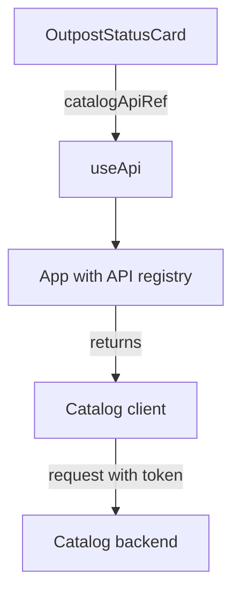

# Reading Catalog Data With useApi And catalogApiRef

A portal card that shows the outposts of the Starfleet needs data from the software catalog, the Backstage service that stores entities such as components and systems. A component could call the catalog address with `fetch`, but Backstage gives frontend code a better way: the Utility API system. This part shows what a Utility API is, how `useApi` finds one, and how the `OutpostStatusCard` uses `catalogApiRef` to request entities.

## Why the card does not call fetch

The first version of the card calls `fetch` with a fixed address in the middle of the render function:

```tsx
fetch('/api/catalog/entities')
  .then(response => response.json())
  .then(items => setOutposts(items));
```

This has four problems. The address is fixed in the code, and a relative address goes to the server that sends the frontend, not to the backend. Backstage keeps the backend address in `app-config.yaml` under `backend.baseUrl`. The request carries no sign-in token, so a catalog that requires authentication answers with an error. The response is not typed. And the call runs on every render, and the `setOutposts` call at the end causes another render, which sends another request. The request loop never ends.

A Utility API fixes these problems. It is an object the app provides to every component, for example a catalog client, an error reporter or an identity service. The app wires each one with the correct base URL (the web address of the backend) and authentication. A component asks for the API by its reference instead of building a client.

## ApiRef and useApi

An `ApiRef` is a typed key that identifies one Utility API. The catalog's key is `catalogApiRef`, exported by `@backstage/plugin-catalog-react`. The hook `useApi`, exported by `@backstage/core-plugin-api`, takes a key and returns the matching object from the app:

```tsx
import { useApi } from '@backstage/core-plugin-api';
import { catalogApiRef } from '@backstage/plugin-catalog-react';

const catalogApi = useApi(catalogApiRef);
```

TypeScript infers the type of `catalogApi` from the key, so you do not annotate it. `useApi` works only for components below the app provider, which is the case for every component rendered from `App.tsx`. Called outside that tree, it throws an error. The app, not your component, chooses which implementation sits behind the key. A test can supply a fake catalog client in its place, and the component code stays the same.

The diagram shows who does what.



The diagram shows that the card never touches the address or the token: the catalog client from the app sends the request.

## Calling getEntities

The catalog client has methods such as `getEntities`, `getEntityByRef` and `getEntityFacets`. `getEntities` takes an optional object with a `filter`. It returns a promise (an object for a value that arrives later) that resolves to an object with an `items` array of entities:

```tsx
const response = await catalogApi.getEntities({
  filter: { kind: 'Component', 'spec.type': 'outpost' },
});
const outposts = response.items;
```

The filter asks the backend to return only components whose `spec.type` is `outpost`. Filtering on the server sends less data to the browser than filtering the full list in the component. Keys with a dot, such as `'spec.type'`, need quotes in an object literal.

An entity is an object with `kind`, `metadata` (name, namespace, optional `title`) and `spec`. In the example catalog, `outpost-alpha` has a `title`, and `outpost-beta` does not. A component that shows `entity.metadata.title` alone would show nothing for the second one, so it falls back with `entity.metadata.title ?? entity.metadata.name`.

## Where the request must run

`getEntities` is asynchronous, but a React render function is synchronous. You cannot write `await` in the body of a component. Calling the method in the body starts a request on every render. The request belongs in an effect or in a hook that wraps one. The next steps use `useAsync`, a hook from the `react-use` package that runs an async function after the render and keeps its result.

## Compare the two versions in the playground

<!-- astrona:playground:renew -->

The playground holds the finished card. Read the imports and the call to `useApi`:

```sh
cd ~/backstage-app
cat plugins/scout-status/src/components/OutpostStatusCard/OutpostStatusCard.tsx
grep -n "useApi\|catalogApiRef\|getEntities" -r plugins
```

Check that the plugin lists the packages it imports, because an import from a package that is not in `package.json` fails in a real build:

```sh
grep -n "plugin-catalog-react\|core-plugin-api\|react-use\|catalog-model" plugins/scout-status/package.json
```

Then search for any hard-coded address and any `fetch` call in the plugin. A well-formed plugin has neither:

```sh
grep -rn "fetch(\|baseUrl" plugins
```

Read the entity file to see the data the filter works on, and decide which of the three outposts the filter `spec.type: outpost` returns:

```sh
cat catalog/outposts.yaml
```

All three have `spec.type: outpost`, so the filter returns all three. If you change the type of one entity to `station` in your copy of the file, the filter would drop it. The playground does not run a catalog backend, so you reason from the files.

## Other API references

`catalogApiRef` is one of many. The same pattern works for `errorApiRef` (report an error to the user), `identityApiRef` (the signed-in user), `configApiRef` (read `app-config.yaml` values) and `discoveryApiRef` (find a backend plugin's base URL). A plugin can also define its own `ApiRef` and register an implementation with `createApiFactory` in the plugin definition, so that its components use `useApi` too.

You now know how a component obtains the catalog client and what a request through it looks like. The open question is what the card should show while the promise is pending, when it fails, and when it returns an empty list.

## Common pitfalls

> [!WARNING]
> Do not call `fetch` or `getEntities` directly in the body of a component: every render repeats the request. Do not hard-code the backend address. Do not call `useApi` outside the app tree. Do not assume `metadata.title` exists; fall back to `metadata.name`.
