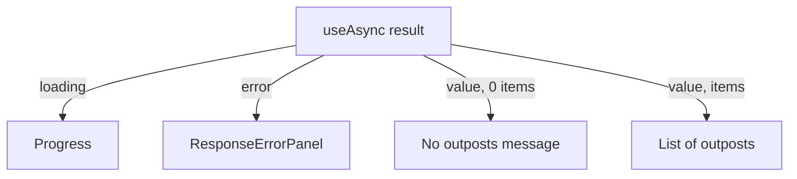

# Loading, Empty, Success And Error States

A request to the catalog has more than one outcome, and each one needs its own screen. If the card treats them alike, a user sees a blank box and cannot tell whether the data is late, missing or broken. This part shows how `useAsync` reports the progress of a request, how `Progress` and `ResponseErrorPanel` display the first and last outcome, and how the card separates an empty answer from a successful one.

## What useAsync returns

`useAsync` comes from the `react-use` package. Backstage code imports it as `import useAsync from 'react-use/lib/useAsync';`. You pass it an async function and a dependency array. It runs the function after the render and returns an object with three fields: `loading`, `error` and `value`.

```tsx
const { value, loading, error } = useAsync(async () => {
  const response = await catalogApi.getEntities({
    filter: { kind: 'Component', 'spec.type': 'outpost' },
  });
  return response.items;
}, [catalogApi]);
```

Before the promise settles, `loading` is `true`. If the function returns, `value` holds the returned value and `loading` is `false`. If it throws or the promise rejects, `error` holds the error object. The dependency array works as it does for `useEffect`: `useAsync` runs the function again only when a listed value changes. The catalog client from `useApi` keeps the same identity between renders, so `[catalogApi]` means "run once".

If the function reads a prop such as an `owner` filter, that prop goes into the array. Without it the card would keep showing the first owner's outposts after the prop changes. `useAsync` also ignores a result that arrives after the component has left the page or after the dependencies changed again, so an old response does not overwrite newer state.

## Four outcomes

The result fields combine into four cases. Loading means the request is pending. Error means the request failed. Empty means the request worked and returned zero items. Success means the request worked and returned at least one item. The empty case is not an error: a catalog without outposts is a valid answer, and the text should say so.



The diagram shows one branch for each outcome, so every state has its own screen.

## Progress and ResponseErrorPanel

`Progress` and `ResponseErrorPanel` are both exported by `@backstage/core-components`. `Progress` shows a progress bar and takes no required props. `ResponseErrorPanel` takes an `error` prop and shows its name, message and details in a panel with a stack trace section. Because it can expose details of a failed request, use it for tool-style pages where the audience is people who run the portal, and use a short message of your own where end users should not see internals.

The JSX for the four branches can be written with `&&`:

```tsx
const outposts = value ?? [];

return (
  <div aria-live="polite" aria-busy={loading}>
    {loading && <Progress />}
    {error && <ResponseErrorPanel error={error} />}
    {!loading && !error && outposts.length === 0 && (
      <p>No outposts found in the catalog.</p>
    )}
    {!loading && !error && outposts.length > 0 && (
      <ul aria-label="Outposts">{/* list items */}</ul>
    )}
  </div>
);
```

`value ?? []` handles the time when `value` is still `undefined`. Each condition rules out the others, so exactly one branch shows. An `if` with an early `return` per state works as well; the version with one wrapper keeps the live region in the page for every state.

## Failure reasoning

The states stand for different facts. A timeout does not prove that no outposts exist. An empty list does not prove that the backend is down. A `401` or `403` response is an authorization problem, which a retry does not solve. Do not map an error to the empty message, because the user would conclude that the catalog has no outposts. Do not map the empty list to the error panel either, because the user would look for a fault that does not exist.

## Read the states in the playground

<!-- astrona:playground:renew -->

Open the card and find the three fields that come out of `useAsync`:

```sh
cd ~/backstage-app
grep -n "useAsync\|loading\|error\|value" plugins/scout-status/src/components/OutpostStatusCard/OutpostStatusCard.tsx
```

Check that each state has one line that renders it:

```sh
grep -n "<Progress\|<ResponseErrorPanel\|No outposts\|<ul" plugins/scout-status/src/components/OutpostStatusCard/OutpostStatusCard.tsx
```

Now edit the file with `nano` and change the empty condition from `outposts.length === 0` to `outposts.length === 1`. Ask what a user with zero outposts would see: none of the four branches matches, so the card is blank. Change it back. This is the kind of gap a reviewer looks for: list the four outcomes and find the line for each.

To see how the dependency list affects the request, change `[catalogApi]` to `[]` and note that the card now ignores any later change of values the callback reads. For this card that makes no difference, because the callback reads only `catalogApi`. For a card with an `owner` prop it would be a bug. Restore `[catalogApi]` before you leave.

## Errors that you create yourself

The error of `useAsync` is whatever the function throws. The catalog client throws an error for a non-successful response. If you need to treat a special case, for example an entity that must exist but is missing, throw an error with a clear message inside the callback instead of returning `undefined`. The `ResponseErrorPanel` then shows that message.

You now know how the card tells loading, failure, an empty answer and data apart, and why each needs its own screen. The open question is how the list itself should be built so that React and assistive technology handle it correctly.

## Common pitfalls

> [!WARNING]
> Do not show the empty message while `loading` is `true` or `error` is set. Do not leave a prop out of the `useAsync` dependency array. Do not treat an error as an empty list. Do not forget `value ?? []`: `value` is `undefined` until the request succeeds.
