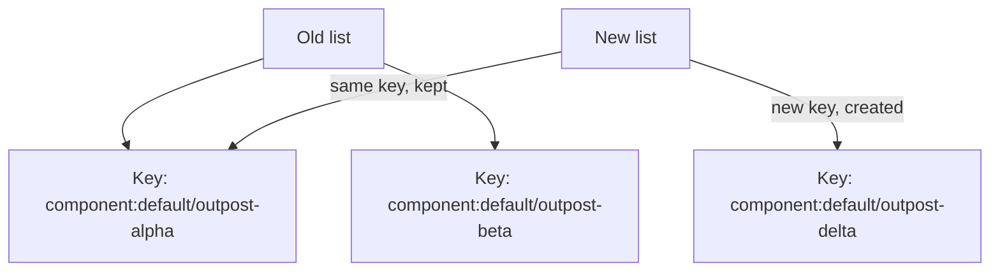

# Stable Keys And Accessible Output

A list from the catalog changes: entities are added, removed and sorted. React needs a way to know which item is which across renders, and people who use screen readers need to learn when the content changes. This part explains the `key` prop, why the list position is a poor key, how `stringifyEntityRef` gives each entity a stable identity, and how a live region and a list label make the card usable with assistive technology.

## What a key does

When a component renders a list, React compares the new list with the old one. The `key` prop tells React which new element matches which old element. React keeps the state and the page node of a matched element and only updates what changed. Without a good key, React matches by position.

The starting card uses the position:

```tsx
{outposts.map((entity, index) => (
  <li key={index}>{entity.metadata.name}</li>
))}
```

Suppose each row also contains a text field that the user has typed in. If a new outpost is added at the top, every row moves down by one position. React matches by index, so the typed text stays at position two while the entity that it belonged to is now at position three. The state follows the position, not the item. A stable key avoids that mismatch.

## Keys from the entity reference

A good key is unique among siblings and stays the same for the same item. A catalog entity has an entity reference: a string of the form `kind:namespace/name`, such as `component:default/outpost-alpha`. The function `stringifyEntityRef` from `@backstage/catalog-model` builds it from an entity:

```tsx
import { stringifyEntityRef } from '@backstage/catalog-model';

{outposts.map(entity => (
  <li key={stringifyEntityRef(entity)}>
    {entity.metadata.title ?? entity.metadata.name}
  </li>
))}
```

An entity reference is unique in the catalog, so it works as a key even when the list mixes kinds and namespaces. The display name does not work, because two entities in different namespaces can share a name, and a title can change. A random value such as `Math.random()` does not work either: it changes on every render, so React treats every item as new and recreates every row.



The diagram shows that React keeps the rows whose key appears in both lists and creates a row only for the new key.

## Optional data and honest props

The catalog does not guarantee every field. A `spec.owner` can be missing, and its type in the generated entity type is not narrowed. A component that receives an owner as a prop should say so in its type: `owner?: string`. When the parent has an unknown value, narrow it instead of asserting it:

```tsx
owner={typeof entity.spec?.owner === 'string' ? entity.spec.owner : undefined}
```

The expression `entity.spec?.owner as string` makes the compiler stop complaining but does not make the data a string. If the value is missing, the child fails at run time. The child then shows `Owner not recorded` for the missing case.

## Accessible output

Accessibility means that people who use a keyboard, a screen reader or a high-contrast display can use the feature. Shared components from Backstage and Material UI help, but a composition still needs checks. Three rules apply to this card.

First, a screen reader does not announce a change of content by default. An element with `aria-live="polite"` is a live region: the screen reader announces changes inside it after it finishes its current speech. `aria-busy` tells the reader the region is still updating. Put the live region around all states, so it is already in the page when the content switches from the progress bar to the list.

Second, a list needs a name when the page has more than one. `aria-label="Outposts"` on the `ul` gives the screen reader a name to announce. Third, never use color alone to show health. A green dot and a red dot mean nothing to a person who cannot see the color, so add text such as `healthy` or `failing`.

## Apply the rules in the playground

<!-- astrona:playground:renew -->

List every key in the plugin, and check that none uses a position or a random value:

```sh
cd ~/backstage-app
grep -rn "key=" plugins
grep -rn "index\|Math.random" plugins
```

Check the live region and the label:

```sh
grep -rn "aria-" plugins
```

Open the card with `nano` and make two experiments. First, change the key to `key={entity.metadata.name}`. The names in `catalog/outposts.yaml` are unique, so the list still works. Ask when it would fail: a second entity with the same name in another namespace gives two siblings with the same key, and React reports a duplicate-key warning. Change it back to `stringifyEntityRef(entity)`. Second, remove `aria-live="polite"` and note which of the four states the screen reader would stop announcing.

A reviewer checks a list change with three questions. Is each key unique and stable? Is every optional value typed as optional? Does a person who cannot see the screen learn about the loading and error states?

## Security stays on the server

A polished card does not protect data. If the catalog contains outposts that some users must not see, the backend decides, through the permission framework and authentication. Hiding a row in the browser removes it from the page but not from the response. Frontend code improves how data is shown; it is never the place that decides who may read it.

You now know how to key a list from the catalog, how to type optional data honestly and how to make the states visible to assistive technology. The card is complete: it gets its client with `useApi`, loads with `useAsync`, separates four states and renders a stable, labelled list.

## Common pitfalls

> [!WARNING]
> Do not use the list position, a random value or a display name as a key. Do not use `as string` to silence a type error on optional data. Do not put the live region inside a branch that disappears while loading. Do not use color alone for a status, and do not treat a hidden row as protected data.
