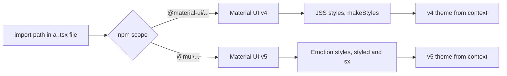

# Material UI Versions And Import Paths

A Backstage page is built from React components, and most of the basic ones come from Material UI (MUI), a library of ready-made interface components such as buttons, text styles and layout grids. The library exists in two major generations that look similar in code but are different packages with different rules. A plugin that mixes them can compile on one machine and render without styles on another. This chapter shows how to tell the generations apart, how an import path identifies the library you use, and why every import must match a declared dependency.

## Two generations, two package families

Material UI version 4 (v4) is published under the npm scope `@material-ui`. Its main package is `@material-ui/core`, with icons in `@material-ui/icons` and experimental components in `@material-ui/lab`. Material UI version 5 (v5) is published under the scope `@mui`: `@mui/material`, `@mui/icons-material` and `@mui/lab`. A scope is the `@name/` prefix of an npm package name.

The two families have different names, so a package manager can install both in one project without a conflict. That is why mixing them is possible and also why it is easy to do by accident. Copying an example from the internet is the usual cause: the example imports `@mui/material`, the plugin declares `@material-ui/core`, and nothing stops the editor from accepting both lines.

The generations also use different styling engines. A styling engine is the code that turns style rules written in JavaScript into CSS (Cascading Style Sheets) and attaches it to the page. v4 uses JSS, with the `makeStyles` hook as its main API. v5 uses Emotion, with `styled` and the `sx` prop. Each engine reads its own theme object from React context, a mechanism that passes a value down the component tree without passing it through every component.

Consider what this means for one theme. A component from `@mui/material` looks for a v5 theme in context. A component from `@material-ui/core` looks for a v4 theme. If only one of them is provided, the other generation falls back to its built-in default look: blue buttons and a white background that ignore the portal theme.

Backstage handles this in the application, not in the plugin. The `UnifiedThemeProvider` component from `@backstage/theme` takes one theme and provides it to both generations at the same time. The plugin author still has to choose one generation per plugin and keep it consistent, because the provider can fix the theme but not a missing dependency.



The diagram shows that the scope in the import path decides the generation, the styling engine and the theme the component reads.

## Reading the imports of a real plugin

The playground has a small Backstage-style project in `/home/candidate/backstage-app`. It has no `node_modules`, so nothing can build, but the source files are enough to see which generation each file uses. The first step is to list every Material UI import in the project.

<!-- astrona:playground:renew -->
Run this search from the project root:

```sh
cd ~/backstage-app
grep -rn "@material-ui\|@mui" plugins packages --include=*.ts --include=*.tsx
```

Each line names a file, a line number and an import. In the starting project every match uses the scope `@material-ui`, so the plugin is a v4 plugin. Next, look at what the plugin declares:

```sh
cat plugins/scout-status/package.json
```

The `dependencies` object lists `@material-ui/core` and `@material-ui/icons`, and it does not list any `@mui` package. These two facts agree, so the plugin is consistent. The rule to remember is simple: the imports in the source files must match the dependencies in `package.json`.

## Why declared dependencies matter

Backstage projects are monorepos, repositories that hold an app and several plugins together and install their packages with Yarn workspaces. A workspace install can hoist a package, which means it places the package in the root `node_modules` folder where every workspace can reach it. An import of `@mui/material` can therefore work in one plugin only because another package in the repository declares it.

That hidden dependency breaks when the plugin is published or moved to another repository. The plugin then runs without the package it never declared. Backstage ships ESLint rules, static checks run by a linter, that report imports of packages that are not declared. Treat such a report as a real defect, not as a style warning.

The same logic applies to peer dependencies. A peer dependency is a package the plugin expects the host application to provide, for example `react`. The plugin file lists `react` and `react-router-dom` as peers because the application supplies one copy of each.

## A mixed import, step by step

Here is a file that mixes the generations. It is shown for reading; do not paste it into the playground.

```tsx
import Button from '@mui/material/Button';
import Typography from '@material-ui/core/Typography';
import { makeStyles } from '@mui/styles';
```

The first line imports a v5 button. The second imports a v4 text component. The third imports `makeStyles` from `@mui/styles`, a legacy package that carries the v4 style hook into v5 projects. It reads a v5 theme from context, so `theme.spacing` inside it works only when the v5 provider is mounted.

Three things can go wrong with this file. The package `@mui/material` is not declared, so the lint rule reports it. The button and the text use different styling engines, so the page loads both engines and ships two copies of the base styles. The style hook needs a v5 theme context that the plugin never created. The fix is to pick the generation the plugin declares and change all three lines to it.

```tsx
import Button from '@material-ui/core/Button';
import Typography from '@material-ui/core/Typography';
import { makeStyles } from '@material-ui/core/styles';
```

## Import paths: default and named

Both generations accept two import styles. A path import loads one component: `import Grid from '@material-ui/core/Grid'`. A named import loads it from the package root: `import { Grid } from '@material-ui/core'`. The two give the same component. The difference is in what a build tool must analyze. Path imports are simple for any tool; named imports from the root depend on the bundler removing unused exports. Many Backstage plugins use path imports for v4, and the project lint rules can require them.

Read the import style of a file before you add a line, and copy it. A file that already uses `@material-ui/core/Grid` should not suddenly import `{ Typography } from '@material-ui/core'`.

## Where Backstage components fit

Backstage adds its own components in `@backstage/core-components`: `InfoCard`, `Page`, `Header`, `Content`, `Progress`, `Table` and the status components. They are built on Material UI, and the Backstage maintainers have been migrating them between generations. A plugin does not need to care which generation they use internally, because the theme provider covers both. It does need to import them from `@backstage/core-components` and not copy their code.

There is also a separate component set called Backstage UI, which is not Material UI. The imports `@backstage/ui` and `@material-ui/core` are different libraries with different themes. Identify which one the installed project uses before you adapt an example.

## Reading order for an unknown project

When you open a project for the first time, check four places in this order. First, read `package.json` of the plugin for `@material-ui` or `@mui`. Second, read the imports of the component you will edit. Third, check the app for `UnifiedThemeProvider`. Fourth, search the whole project for the other scope, because a single stray import is the usual source of a styling defect.

```sh
grep -rn "@mui" plugins/scout-status
```

On the starting project this search prints nothing, which is the result you want in a v4 plugin. You now know how to read the generation of a project from its imports and its `package.json`. The next question is what to do with the components once the generation is fixed.

## Common pitfalls

> [!WARNING]
> Do not copy an example without reading its import scope. `@mui` in the example and `@material-ui` in your `package.json` is a mismatch. Do not fix a missing package by installing the other generation; change the imports to the generation the plugin already declares. A hoisted package that works locally is not a declaration.
