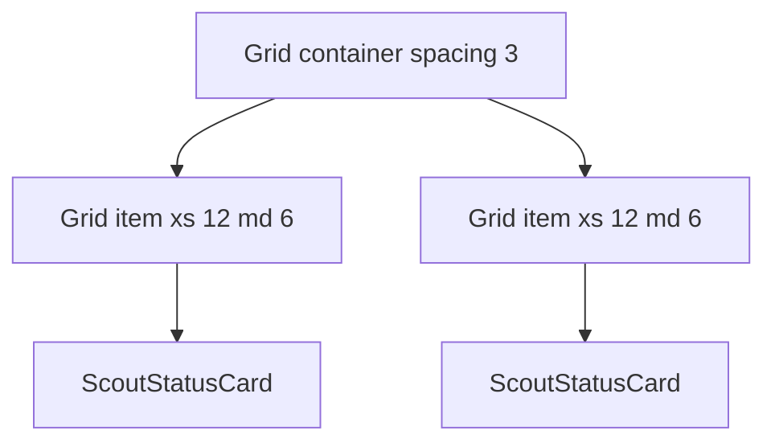

# Layout And Content Components: Grid, Typography, Button And Card

Once a plugin uses one Material UI generation, the next job is to put content on the page. Four components do most of the work in a Backstage plugin: `Grid` for layout, `Typography` for text, `Button` for actions and a card for grouping. This chapter explains what each component renders, which props change its behavior and where Backstage replaces a plain Material UI component with its own. The examples use the v4 API that the example plugin declares.

## Grid: a twelve-column layout

`Grid` is a layout component built on CSS flexbox, the browser layout mode that arranges children in a row and wraps them when space runs out. A `Grid` has two roles. A grid container (`container`) lays out its children in a row with wrapping. A grid item (`item`) is a child that takes a share of the row.

The share is set with breakpoint props. A breakpoint is a screen width at which the layout may change: `xs` (extra small, phones), `sm`, `md`, `lg` and `xl`. Each prop holds a number from 1 to 12, the number of columns of a twelve-column row. `xs={12}` means the item is full width from the smallest screen up. `md={6}` means it takes half the row from the medium breakpoint up.

The `spacing` prop on the container sets the gap between items. The value is multiplied by the theme spacing unit, which is 8 pixels by default, so `spacing={3}` gives a 24 pixel gap.

This is the list component of the example plugin:

```tsx
export const ScoutList = (props: { scouts: Scout[] }) => (
  <Grid container spacing={3}>
    {props.scouts.map(scout => (
      <Grid item xs={12} md={6} key={scout.name}>
        <ScoutStatusCard scout={scout} />
      </Grid>
    ))}
  </Grid>
);
```

On a phone each card fills the row. On a wide screen two cards share a row. The `key` prop is not a layout prop: React uses it to track list items between renders, and it must be unique among the siblings.

Grid is only layout. It does not know what a scout is and it does not decide what the cards mean. A fixed pixel width on an item would defeat the breakpoints, which is why the project leaves widths to the grid.



The diagram shows one container that holds items, and each item holds one card, so the grid owns the position and the card owns the content.

## Typography: text with a style and an element

`Typography` renders text with a named style from the theme. The `variant` prop picks the style: `h1` to `h6` for headings, `subtitle1`, `body1`, `body2`, `caption` and others. A variant maps to a default HTML element: `h1` renders an `<h1>`, `body2` renders a `<p>`.

Style and element are separate decisions. A heading in a card may need the look of `subtitle1` and still be a heading for screen readers, which are programs that read the page aloud and let users jump between headings. The `component` prop sets the element: `<Typography variant="subtitle1" component="h2">`. Choose the element for the structure of the page and the variant for the look.

Text that the user must read should use `Typography` and not a bare `div`, because the theme then controls font, size and color for every appearance of the portal.

## Button: action or navigation

`Button` renders a `<button>` element by default. The `variant` prop (`text`, `outlined`, `contained`) sets the visual weight, and `color` selects a palette color such as `primary`. When the `href` prop is present, the component renders an `<a>` element instead. That is correct semantics: a button performs an action in the page, a link goes somewhere else.

In the example card the button opens a catalog page:

```tsx
<Button
  variant="outlined"
  color="primary"
  href={`/catalog/default/component/${scout.name}`}
>
  Open in catalog
</Button>
```

A plain anchor causes a full page load, because the browser does not know the destination is part of the same single-page app. A Backstage app has its own router, React Router, which changes the view without a reload. For links inside the portal, Backstage provides `Link` in `@backstage/core-components`, which uses the router. You can render a button as that link with `component={Link}` and a `to` prop. The `href` version in the example works for a path that the server can serve, but it is the slower choice.

An action that changes data, such as a refresh, uses `onClick` and stays a button. Never put `onClick` on a `div` or a `span`: it will not receive keyboard focus and it will not respond to the Enter and Space keys.

## Card and InfoCard

Material UI has `Card`, `CardHeader` and `CardContent`. They give a surface with a border or shadow, a header area and a padded body. They know nothing about Backstage.

`InfoCard` from `@backstage/core-components` wraps the same idea for the portal. It takes a `title` and an optional `subheader`, can show a `deepLink` (a title and a link to a related page), can hold `actions` in a footer, and its `variant` prop adapts the height inside a grid (for example `gridItem`). It also wraps its content in an error boundary, a React component that catches rendering errors in its children, so one broken card does not blank the whole page.

The example card therefore reads:

```tsx
<InfoCard title={scout.name}>
  <ScoutStatusBadge state={scout.state} name={scout.name} />
  <Typography variant="body2" className={classes.detail}>
    Last report: {scout.lastReport}
  </Typography>
  <Button variant="outlined" color="primary" href="...">
    Open in catalog
  </Button>
</InfoCard>
```

Use the Backstage component when one exists. It keeps the card look the same on every page of the portal, and an update to the portal theme or to the card reaches your plugin without a code change.

## Page structure

A routable plugin page usually starts with `Page`, `Header` and `Content` from `@backstage/core-components`. `Page` sets the page theme through `themeId`, `Header` draws the colored title band and `Content` supplies the padded main area. Grids and cards go inside `Content`.

## Inspecting the components in the playground

Now look at the real files. The playground project uses all four components.

<!-- astrona:playground:renew -->
Print the card and the list:

```sh
cd ~/backstage-app
cat plugins/scout-status/src/components/ScoutStatusCard.tsx
cat plugins/scout-status/src/components/ScoutList.tsx
```

Check which props drive the layout and where the Backstage card replaces a Material UI card:

```sh
grep -n "Grid\|InfoCard\|Typography\|Button" plugins/scout-status/src/components/*.tsx
```

Try changing `md={6}` to `md={4}` in `ScoutList.tsx` with `nano` and read the line again. A twelve-column row holds three items of four columns, so the result is three cards per row on medium and larger screens. Put the original value back afterwards.

You now know which component owns layout, text, actions and grouping, and when a Backstage component replaces a Material UI one. The remaining question is how to style these components without hard-coding values.

## Common pitfalls

> [!WARNING]
> `Grid item` outside a `Grid container` has no effect on the row. Fixed pixel widths on items override the breakpoints. A `Button` with `href` reloads the page for in-app routes. A `Typography` variant changes the look but not the HTML element, so set `component` when the structure matters. Do not replace `InfoCard` with a plain `Card` unless the page really needs no Backstage behavior.
