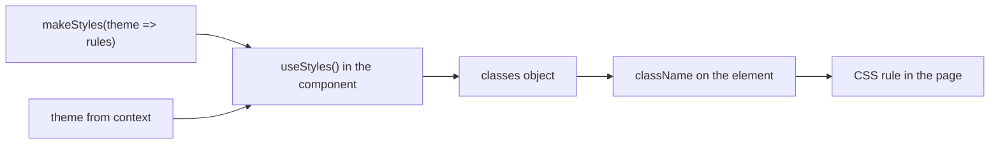

# Styling With makeStyles And styled

Components come with a default look, and a plugin often needs a small change: a margin between two lines, a border around a toolbar. Each Material UI generation has its own way to write such styles, and both read values from the portal theme. This chapter explains the style API of each generation, what each one produces and why spacing and colors should come from the theme argument and not from numbers typed into the file.

## makeStyles in Material UI v4

`makeStyles` is the v4 styling function. It takes a function that receives the theme and returns an object of style rules. It returns a React hook, a function a component calls to get data from React. The hook returns an object named `classes`, whose keys are the rule names you wrote.

```tsx
import { makeStyles } from '@material-ui/core/styles';

const useStyles = makeStyles(theme => ({
  detail: {
    margin: theme.spacing(2, 0),
  },
}));

export const ScoutStatusCard = (props: { scout: Scout }) => {
  const classes = useStyles();
  return <p className={classes.detail}>Last report: {props.scout.lastReport}</p>;
};
```

Follow the steps. `makeStyles` runs once, when the file loads, and returns the hook. When the first component that uses the hook renders, `useStyles()` reads the current theme from context, calls your function with it and returns generated class names. The value of `classes.detail` is a string such as `makeStyles-detail-12`, unique to the rule. The component puts that string in `className`, and the browser applies the CSS to the element.

The important part is the argument. `theme.spacing(2, 0)` asks the theme for two spacing steps vertically and none horizontally. With the default 8 pixel unit, v4 returns the string `16px 0px`. If the portal theme changes the spacing unit, this card follows without a code change. A literal `margin: '16px 0'` would not.

`makeStyles` also accepts a plain object without a function: `makeStyles({ root: { display: 'flex' } })`. That form is fine for rules that use no theme value. As soon as a value is a color, a spacing step or a font, switch to the function form.



The diagram shows that the theme reaches the style function through React context and the result reaches the element as a class name.

## styled and sx in Material UI v5

v5 offers two main APIs. `styled` wraps a component or an HTML tag and returns a new component with the styles attached. The `sx` prop applies theme-aware styles to one element in place.

```tsx
import { styled } from '@mui/material/styles';
import Box from '@mui/material/Box';

const Detail = styled('p')(({ theme }) => ({
  margin: theme.spacing(2, 0),
}));

export const Example = () => (
  <Box sx={{ p: 2, color: 'text.secondary' }}>
    <Detail>Last report: today</Detail>
  </Box>
);
```

`styled('p')` returns a component that renders a `<p>`. Its callback receives an object with the theme. In `sx`, the shorthand `p: 2` means `padding: theme.spacing(2)` and the string `'text.secondary'` is looked up in the theme palette. Emotion, the v5 styling engine, generates the class name.

The two APIs solve the same task with different syntax. A rule with `theme => ({...})` in v4 becomes `({ theme }) => ({...})` in v5, and a hook with class names becomes a component or an `sx` object. These are not interchangeable: `sx` does not exist in v4 components, so `<Box sx={{ mb: 2 }}>` in a v4 plugin has no effect or a type error. The example in the lab fails for exactly that reason.

## Equivalent rules, side by side

The same margin in both generations:

```tsx
// v4, package @material-ui/core
const useStyles = makeStyles(theme => ({ detail: { margin: theme.spacing(2, 0) } }));

// v5, package @mui/material
const Detail = styled('p')(({ theme }) => ({ margin: theme.spacing(2, 0) }));
```

Both read `theme.spacing` and both stay correct when the theme changes. In both cases the number comes from the theme and not from the file.

## Theme overrides

A portal can change a component for every use, without touching the plugin. In v4 a theme has an `overrides` key that targets component rule names, for example the root rule of `MuiButton`. In v5 the equivalent is `components` with `styleOverrides`. Backstage uses this to give its own look to Material UI components. A plugin that writes its own style on top of a component should write only what is specific to the plugin and let the theme override do the rest.

## Reading styles in the playground

You can see the v4 pattern in the real project. The card and the panel both use `makeStyles` with a theme function.

<!-- astrona:playground:renew -->
Search for every style definition in the plugin:

```sh
cd ~/backstage-app
grep -rn "makeStyles\|theme\." plugins/scout-status/src
```

The matches show the import of `makeStyles` from `@material-ui/core/styles`, the callback taking `theme`, and calls such as `theme.spacing(2, 0)`. Print the panel file to see a style that also reads a color:

```sh
cat plugins/scout-status/src/components/ScoutPanel.tsx
```

In this file `border` is built from `theme.palette.divider` and `color` from `theme.palette.text.primary`. Those two names are part of the palette that Material UI and the Backstage theme both provide, so they exist in every appearance of the portal.

Now try a safe experiment. Copy the file, change `theme.spacing(2)` for `marginBottom` to `theme.spacing(4)` with `nano`, and read the line again. The margin doubles in the rendered page, and only the one number in the file changed. Restore the copy afterwards.

## Choosing between the two APIs

The choice follows the generation of the plugin, not taste. A plugin with `@material-ui/core` uses `makeStyles`. A plugin with `@mui/material` uses `styled` or `sx`. Moving a plugin from one to the other is a migration of the whole plugin, including `package.json`, imports and styles, and not a change to a single file.

If the style engine of the other generation is also installed, the page loads both. The unified theme provider makes both read the same theme, but a plugin should still not use both without a reason, because it doubles the style code the browser loads and makes class name ordering harder to reason about.

You can now write a style that follows the portal theme in either generation. The next question is where that theme comes from and how it changes between light and dark appearances.

## Common pitfalls

> [!WARNING]
> Do not use `sx`, `styled` or `@mui/styles` in a plugin that declares Material UI v4. Do not type pixel values or color codes where a `theme.spacing` or `theme.palette` value exists. `makeStyles` hooks must be called inside a component, not outside. A class name from `classes` is a string for `className`; it is not an object to spread into props.
