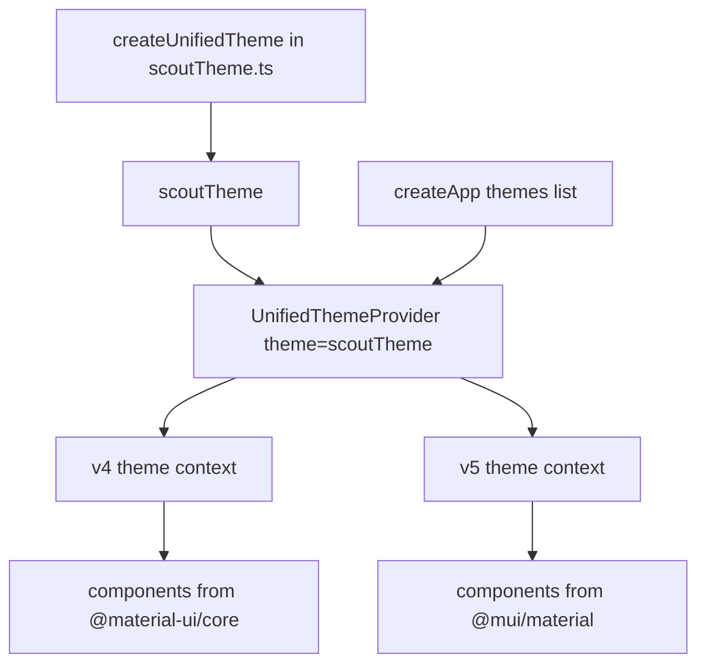

# Creating And Registering A Theme

Every color, font and spacing step in a Backstage portal comes from a theme. A theme is an object that holds the design values of the interface, and components read it instead of storing their own values. An organization that wants its own brand color changes the theme once and every plugin follows. This chapter shows how Backstage builds a theme, how the application registers it and what has to be true for both Material UI generations to see the same values.

## What a Backstage theme contains

The package `@backstage/theme` provides `createUnifiedTheme`. It builds one theme that works for both Material UI v4 and v5 components. The result is called a unified theme. You pass it an options object with the parts you want to change:

- `palette`, the set of colors. A palette has groups such as `primary`, `secondary`, `error`, `warning`, `info` and `success`, plus `text`, `background` and `divider`.
- `defaultPageTheme`, the name of the page theme used by page headers when a page gives none. A page theme is the colored band behind a page title.
- `pageTheme`, optional page themes by name.
- `typography`, `fontFamily`, `shape` and `components` for fonts, corner shapes and per-component overrides.

You rarely write a whole palette. The package exports `palettes.light` and `palettes.dark`, which hold the Backstage default colors, and the unified theme also ships ready-made `themes.light` and `themes.dark`. A custom theme spreads one of the default palettes and replaces only the values that differ. The spread operator `...` copies every key of an object into the new object.

This is the theme file of the example portal:

```ts
import { createUnifiedTheme, palettes } from '@backstage/theme';

export const scoutTheme = createUnifiedTheme({
  palette: {
    ...palettes.light,
    primary: {
      main: '#1f6feb',
    },
  },
  defaultPageTheme: 'home',
});
```

Read it from top to bottom. `palettes.light` supplies all default light colors. The `primary` key after the spread replaces the primary group with a new `main` color, and every other color stays as it was. The page theme `home` is one of the default page theme names. The export is a named constant that the application imports.

This is the only file where a color code belongs. A color code typed anywhere else bypasses the theme.

## Registering the theme in the app

Creating a theme does nothing until the application uses it. In an application built with `@backstage/app-defaults`, the `createApp` function takes a `themes` option. Each entry is an app theme: an object with an `id`, a `title`, a `variant` (`'light'` or `'dark'`) and a `Provider` component. Backstage lists these in the appearance settings so a user can choose one, and it mounts the `Provider` around the whole app.

```tsx
import { createApp } from '@backstage/app-defaults';
import { UnifiedThemeProvider } from '@backstage/theme';
import { scoutTheme } from './theme/scoutTheme';

const app = createApp({
  themes: [
    {
      id: 'scout-light',
      title: 'Scout Light',
      variant: 'light',
      Provider: ({ children }) => (
        <UnifiedThemeProvider theme={scoutTheme} children={children} />
      ),
    },
  ],
});
```

`UnifiedThemeProvider` does the work for both generations. It places the v4 theme in the v4 theme context, the v5 theme in the v5 theme context and applies a base style reset to the page. It is the reason a v4 plugin and a v5 plugin can sit on one page with the same colors. The `variant` field is a label: it tells Backstage whether to offer the entry as a light or dark choice and does not change the colors. Colors come from the palette.



The diagram shows one theme object flowing through one provider into the theme contexts that both generations read.

## What the theme list controls

The `themes` list you pass is the list of choices in the settings page. Add one entry for each appearance you support. If the portal offers a dark appearance, add a second entry with `variant: 'dark'` and a theme built from `palettes.dark`. A user whose browser asks for dark mode expects a dark choice.

The new frontend system registers themes as extensions of the app instead of through this `createApp` option. The example project uses the `createApp` option, and the idea is identical: one theme object, mounted through the unified provider.

## Inspecting the theme in the playground

The playground project already has a theme and registers it. Check where each piece is.

<!-- astrona:playground:renew -->
Print the theme file and find where the app uses it:

```sh
cd ~/backstage-app
cat packages/app/src/theme/scoutTheme.ts
grep -n "themes\|UnifiedThemeProvider\|scoutTheme" packages/app/src/App.tsx
```

The search shows the import of `UnifiedThemeProvider` from `@backstage/theme`, the import of `scoutTheme`, the `themes` list and the `Provider`. If any of the four were missing, the portal would use its default look and ignore the custom theme without any error message, because an unused theme file is valid code.

Make a change and trace it. Open `scoutTheme.ts` with `nano`, change the `main` value of `primary` to another color code and save. Every `primary` color in the portal would now change, with no edit in any plugin. Restore the original value afterwards.

## Failure cases

Four mistakes appear often. The first is a theme that is created but never passed to `createApp`: the file compiles and nothing changes. The second is a `Provider` that renders the v5 `ThemeProvider` from `@mui/material` directly: v4 components then ignore the theme. The third is a theme built from `palettes.light` and listed with `variant: 'dark'`: the dark label shows a light page. The fourth is a missing `id` or a duplicate `id`: the settings page cannot tell two appearances apart.

You now know where a theme is created and how it reaches the components. The next question is how a plugin should read it.

## Common pitfalls

> [!WARNING]
> A theme file that nothing imports changes nothing. Do not render a single generation's provider in place of `UnifiedThemeProvider`. Do not rely on `variant` to change colors; the palette decides. Keep every color code in the theme file, because a plugin that carries its own colors will not follow a theme change.
