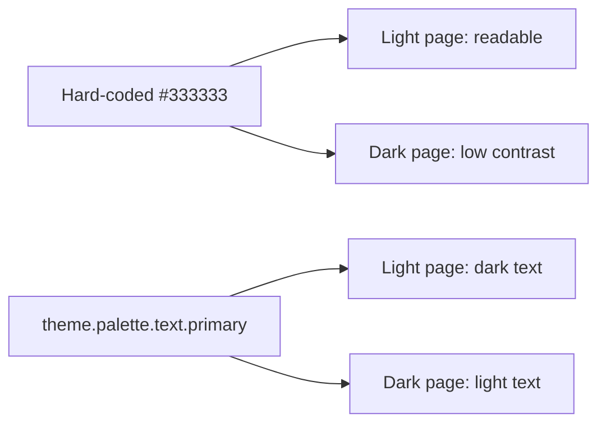

# Theme Tokens And Semantic Controls

A theme only helps when components read it. A component that carries its own color codes looks right in the one appearance its author tested and breaks in the others. This chapter explains theme tokens, shows what a hard-coded color does in a dark appearance and then turns to controls: choosing the right element for an action and giving every control a name that assistive technology can read.

## Theme tokens

A token is a named value in the theme, read by name and not typed as a literal. The theme supplies tokens for colors, spacing and type:

- Color tokens in the palette: `theme.palette.primary.main`, `theme.palette.error.main`, `theme.palette.text.primary`, `theme.palette.background.paper` and `theme.palette.divider`.
- A spacing function: `theme.spacing(2)` returns two spacing steps, 16 pixels with the default 8 pixel unit.
- Typography tokens such as `theme.typography.body2`.

In the v4 style API, the theme arrives as the argument of the function given to `makeStyles`. In v5, it arrives in `styled` and in `sx` strings such as `'text.primary'`. Either way the value is looked up when the component renders, using the theme of the current appearance.

Compare two versions of the panel that holds the toolbar of the example plugin. This is the hard-coded version:

```tsx
const useStyles = makeStyles({
  root: {
    padding: '8px 16px',
    marginBottom: 16,
    border: '1px solid #cccccc',
    color: '#333333',
  },
});
```

And this is the version that uses tokens:

```tsx
const useStyles = makeStyles(theme => ({
  root: {
    padding: theme.spacing(1, 2),
    marginBottom: theme.spacing(2),
    border: `1px solid ${theme.palette.divider}`,
    color: theme.palette.text.primary,
  },
}));
```

The first version fixes the text color to dark gray `#333333`. In a light appearance that is readable. In a dark appearance the page background is dark, and dark gray text on a dark background has almost no contrast, so the toolbar becomes unreadable while the code is unchanged. The second version asks the theme. `text.primary` is dark in the light palette and light in the dark palette, so it stays readable in both. The spacing tokens also let an organization with a denser layout change one spacing unit for the whole portal.



The diagram shows that a literal gives one result in every appearance, while a token follows the active palette.

Contrast is the difference in brightness between text and its background. The Web Content Accessibility Guidelines (WCAG) set minimum contrast ratios for text. Theme palettes are designed with those ratios in mind. A literal color throws that design away, and only the author of the literal can check it.

There is one exception to remember. The theme file itself is the place for color codes. A brand color is a decision about the palette, so it lives in `createUnifiedTheme`, and plugins read it by name.

## Searching for literals

A quick audit finds literals with a regular expression. A regular expression is a search pattern, and the pattern below matches a `#` followed by three to eight hexadecimal characters.

<!-- astrona:playground:renew -->
Run this in the playground project:

```sh
cd ~/backstage-app
grep -rnE "#[0-9a-fA-F]{3,8}" plugins packages --include=*.ts --include=*.tsx
```

In the starting project the only match is the `primary` color in `scoutTheme.ts`, which belongs there. A match in a component file would be a defect to fix. Also search for color functions that a hex search misses:

```sh
grep -rnE "rgba?\(|hsla?\(" plugins packages --include=*.ts --include=*.tsx
```

Then print the panel and compare it with the token version above:

```sh
cat plugins/scout-status/src/components/ScoutPanel.tsx
```

## Semantic controls

A semantic element is an HTML element whose type tells browsers and assistive technology what it does. A `button` performs an action. An `a` element with `href` navigates. A heading element marks a heading. Users of screen readers, keyboards and voice control depend on these meanings, because the browser gives semantic elements focus, keyboard behavior and roles automatically.

Material UI follows the rule. `Button` renders `<button>`, or `<a>` when it has `href`. `IconButton` renders a `<button>` that holds only an icon. A `div` with an `onClick` handler does not receive keyboard focus, does not respond to Enter or Space and has no role, so a user without a mouse cannot reach it.

### Accessible names

An accessible name is the text that assistive technology reads for a control. A `Button` with the text "Open in catalog" has the name "Open in catalog". An `IconButton` that contains only an SVG icon has no text, so it has no name, and a screen reader announces only "button". The `aria-label` attribute supplies the name. ARIA (Accessible Rich Internet Applications) is a set of attributes that give extra meaning to elements.

```tsx
<IconButton aria-label="Refresh scout status" onClick={props.onRefresh}>
  <RefreshIcon />
</IconButton>
```

The label should say what the action does, not what the icon looks like. "Refresh scout status" is useful; "circular arrow" is not. A tooltip that shows on hover helps mouse users but is not the only fix: write the `aria-label` anyway, and do not hide the only explanation of a control in a tooltip.

Read the toolbar in the project:

```sh
cat plugins/scout-status/src/components/ScoutToolbar.tsx
grep -rn "aria-label" plugins/scout-status/src
```

Remove the `aria-label` line with `nano`, search again and see that the match disappears. The code still compiles, which shows why the check must be done by reading the file. Put the line back afterwards.

### Focus and state

Keyboard users move with the Tab key. The control that has focus must be visible. Material UI components keep a focus style, so do not remove it with `outline: none` in a custom style. A control that is busy should be `disabled` or show a progress indicator, so the user does not trigger the action twice. A `disabled` button leaves the Tab order; if the user needs to learn why it is disabled, put the reason in visible text.

You now know how to keep a component readable in every appearance and how to make its controls usable without a mouse. The last question is how to show data states, such as healthy, loading or failed, so that color is not the only signal.

## Common pitfalls

> [!WARNING]
> A hex code in a component file is a defect, even if it looks right today. An icon-only control without `aria-label` has no name. Do not use a `div` with `onClick` instead of a `button`. Do not remove the focus outline. The theme guarantees consistency and designed contrast; it does not make a control accessible by itself.
