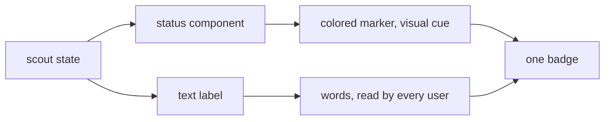
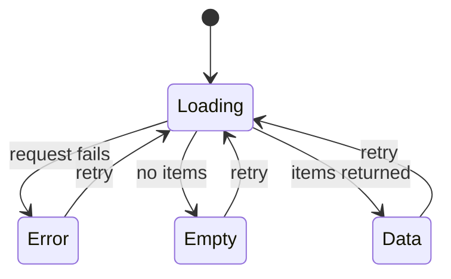

# Accessible Status And Loading States

A status page answers one question: what is the state of each thing? The answer has two parts that are easy to confuse. The first is the state of the data request: loading, failed, empty or done. The second is the state of each item once data exists: healthy, degraded, down or unknown. This chapter shows the Backstage components for both, and explains why every state must be readable without relying on color.

## Status components

`@backstage/core-components` exports a family of status components: `StatusOK`, `StatusWarning`, `StatusError`, `StatusPending`, `StatusRunning` and `StatusAborted`. Each one renders a small colored marker next to its children, which are the text you give it. The marker color comes from the theme, so it follows the active appearance.

The example plugin maps its four states to four components:

```tsx
switch (state) {
  case 'ok':
    return <StatusOK>{name} is operational</StatusOK>;
  case 'degraded':
    return <StatusWarning>{name} is degraded</StatusWarning>;
  case 'down':
    return <StatusError>{name} is down</StatusError>;
  default:
    return <StatusPending>{name} status is unknown</StatusPending>;
}
```

The `default` branch matters. A scout that has not reported has an unknown state. It must not show the green marker of a healthy scout. Treating unknown as healthy is the common mistake: a missing report is not good news.

## Why color alone is not enough

Some users cannot tell green from red because of color vision deficiency. Others use a screen reader, a high-contrast mode or a monochrome print. The Web Content Accessibility Guidelines include a rule, Use of Color, which says that color must not be the only way to convey information. A colored dot alone breaks that rule.

Compare two versions of the badge. The first renders only a dot whose background color depends on the state:

```tsx
return <span className={`${classes.dot} ${classes[props.state]}`} />;
```

A screen reader reads nothing for this element, and a user who cannot see the color difference sees three identical dots. The second version uses the status component with a text child. The text "is down" carries the meaning, and the marker adds a quick visual cue for users who can see it. Both channels deliver the same information.



The diagram shows that the state travels through two channels, a marker and words, and the badge combines them.

## The four data states

A page that loads data from an API has more states than the happy path. The example hook `useScoutStatus` uses `useAsyncRetry` from `react-use`. It returns `value`, `loading`, `error` and a `retry` function. These map to separate screens:

- Loading: the request is pending. Show `Progress` from `@backstage/core-components`, a spinner that appears after a short delay so quick responses do not flash.
- Error: the request failed. Show `ResponseErrorPanel` with the `error` object. It prints the error name and message and offers details, so a user can report what happened.
- Empty: the request succeeded and returned no items. Show `EmptyState` with a `title`, a `description` and a `missing` value such as `data`.
- Data: render the list.

```tsx
let body: React.ReactNode;
if (loading) {
  body = <Progress />;
} else if (error) {
  body = <ResponseErrorPanel error={error} />;
} else if (!value || value.length === 0) {
  body = (
    <EmptyState
      missing="data"
      title="No scouts reported"
      description="No scout has sent a status yet."
    />
  );
} else {
  body = <ScoutList scouts={value} />;
}
```

The order matters. While a retry is running, `loading` is true and the earlier value may still be present, so the loading branch must come first. An error must come before the empty check, because a failed request has no value and would otherwise look like an empty list. Each branch tells the user something different: wait, something failed, or nothing exists yet.



The diagram shows that retry always returns to loading, and that error, empty and data are separate end states.

## Failure cases

The worst version of the page returns `null` while loading and renders an empty list on error. The user sees a blank page in both cases and cannot tell a slow request from a broken one. A second failure is to catch the error and show "No data", which hides a real outage behind an empty state. A third is to show a status marker for stale data as if it were fresh: when the page knows the data is old, it should say so in words. A fourth is a card that truncates its label. If the label is the only explanation of the state, a truncated label can leave only the marker.

The status components do not check anything. They display the state you pass. If the code maps an unreported scout to `ok`, the interface shows green. Correct meaning comes from the data and the mapping, not from the component.

## Inspecting states in the playground

The playground project implements all four states and the badge. Read them.

<!-- astrona:playground:renew -->
Print the page and the badge:

```sh
cd ~/backstage-app
cat plugins/scout-status/src/components/ScoutStatusPage.tsx
cat plugins/scout-status/src/components/ScoutStatusBadge.tsx
```

Check that the page tests loading first, then the error, then the empty list, and that every status component has words as children:

```sh
grep -n "loading\|error\|length\|Progress\|ResponseErrorPanel\|EmptyState" plugins/scout-status/src/components/ScoutStatusPage.tsx
grep -n "Status" plugins/scout-status/src/components/ScoutStatusBadge.tsx
```

Now try a change. In `ScoutStatusPage.tsx` with `nano`, replace `<Progress />` by `null`, then search for `Progress` again. The page would now be blank while loading. Restore the original line afterwards.

You can now present each state of a status page with a component and a text label, and you know which state each branch stands for. The theme, the tokens and these components together make the interface consistent. None of them checks the data or enforces permissions.

## Common pitfalls

> [!WARNING]
> Do not show health with a colored dot alone. Do not map an unknown or stale state to the healthy component. Do not return `null` while loading, and do not render an error as an empty list. The order is loading, then error, then empty. A well-styled card does not prove that the data is current, and a styled button does not enforce authorization; the backend must do that.
